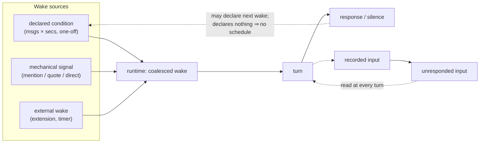

# Agent-declared wake conditions

Status: ready-for-agent

## Problem Statement

Ishiki decides whether to answer at the wrong time and with the wrong kind of intelligence.

Today every inbound message flows through one chain: a settle window batches pending events, then a wakeup engine judges each event, and only then does the runtime open a turn. That chain conflates three different decisions:

1. **When** to look (timing)
2. **Whether the incoming stream is worth answering** (judgement)
3. **What facts exist** (persistence)

Judgement currently happens _before_ the turn, on a per-message basis, with no way to revisit it. That produces two concrete user-visible failures:

- **Interrupting.** Someone @-s the bot with no body because they are still typing. The rule fires on the mention alone, the bot sees nothing but the mention and answers "why did you @ me without saying anything". A human would glance at context first, notice they were still composing, and wait.
- **Permanent silence.** The bot decides "not worth joining" and finishes its turn. The same person then sends a follow-up that carries no strong signal. Nothing re-triggers. The input is recorded into history but never answered — the wait decision was terminal.

Two further problems compound these. The settle window lives inside the runtime with a fixed delay, so any policy spanning longer than a couple of seconds (a class schedule: don't answer while the bot is in class, answer afterwards) cannot be expressed without a workaround extension maintaining its own timer. And the docs describe the core as having "no background timers", which makes extension-driven activity (cron jobs, proactive messages, external events) sound architected out rather than simply not built in — discouraging exactly the extension work the project wants.

## Solution

Move the "should I speak?" intelligence **into the agent**, and reduce everything before the turn to mechanics.

A turn may end with the agent declaring when it wants to be woken next — after how many further inputs, or after how long. Either window firing first wins. A declaration is **one-off, not a schedule**: it fires once and is spent. Nothing is armed unless the agent declares, and there is no global default to fall back to — a turn that declares nothing means "don't wake me by schedule"; only a signal or an outside wake can open the next turn. This is the `nextReplyIn` idea from yesimbot-v2, generalised into a first-class primitive: the two scenarios above are both expressed by the agent choosing `{ msgs: 1 }` plus a short timeout, without any special-case core logic for mentions or trailing messages.

Because the agent controls whether there is a wake condition at all:

- Response rhythm (the old settle debounce) becomes an ordinary declaration, chosen per context by the agent instead of hardcoded in the runtime. It is not a replacement for the settle window at the same place in the flow: the settle window was a mechanism that ran whether or not the agent had anything to say, whereas a declaration exists only when the agent makes one.
- Long-horizon policies (class schedules, quiet hours) become extensions that suppress or request awakenings through the same two primitives the platform path uses. Recurring schedules belong to extension lifecycles, not to this tool.
- "Every input eventually gets a considered response" holds as long as some later wake point arrives — nothing is discarded; the verdict simply isn't rendered until then.
- Timers, cron and external events live in extension-plugin lifecycles and reach any session by address, so the core stays ignorant of platforms and schedules while still being fully schedulable.

Core stays small: **two primitives only** — record input (`deliver`), and request a turn (`wake`/`continue`). Everything else is composed on top.

### Shape

Recording input and requesting a turn are **independent**. Nothing about arriving needs a verdict; nothing about waking needs a new message.

## User Stories

### As a chat user

1. As a user who types a thought across several messages, I want the bot to wait until I finish, so that it answers once instead of jumping in after line one.
2. As a user who @-s the bot and pauses to compose the body, I want it to hold instead of replying to an empty mention, so that I get a reply to what I meant.
3. As a user who @-s the bot and then never follows up, I want it to check back after a short while, so that the baton isn't dropped.
4. As a user who is @-ed into a conversation the bot judged irrelevant, I still want any later message considered rather than discarded, so that a wait decision never becomes permanent silence.
5. As a user in a busy channel, I want the bot to be able to declare "stay out unless directly called", so that it does not inject itself into unrelated topics.
6. As a user in a one-to-one conversation, I want quicker responsiveness than in a group, and I want the bot itself to make that judgement from context.
7. As a user whose message arrives while the bot is mid-reply, I want my message recorded and considered in a following turn rather than being lost or interrupting.
8. As a user whose input was answered alongside earlier inputs, I want it treated once, so that I never get duplicate or replayed answers.

### As an extension developer

9. As an extension developer, I want to schedule the agent (cron, reminders, proactive messages) without understanding runtime internals, so that scheduling is a small amount of code.
10. As an extension developer, I want the same two primitives the platform path uses, so that my extension isn't a second-class producer.
11. As an extension developer, I want to deliver events of my own declared types, so that my domain's events reach the agent.
12. As an extension developer, I want to watch external systems myself (own lifecycles, own listeners), so that the core doesn't need to know about them.
13. As an extension developer, I want to reach a session by address even if nobody has spoken in it yet, so that proactive messages work from cold start.
14. As an extension developer, I want a wake request during an active turn to be coalesced rather than dropped, so that I never have to build my own busy-state handling.
15. As an extension developer, I want a handle tied to the runtime's lifetime with a disposer, so that I can stop my timers cleanly.
16. As an extension developer, I want my errors isolated, so that a fault in my extension doesn't take down the core or anyone else's.
17. As an extension developer, I want a stable, documented core surface, so that upgrades don't break me.
18. As an extension developer building a class-schedule policy, I want to suppress answers while busy and request a wake afterwards, so that delayed responses are natural rather than a workaround.

### As a core developer

19. As a core developer, I want request-a-turn and record-input to be separate primitives, so that arrival needs no verdict and waking needs no new message.
20. As a core developer, I want no platform or schedule logic in the core, so that it stays small and stable.
21. As a core developer, I want extensibility to come from composing primitives, so that new behaviour doesn't grow the surface.
22. As a core developer, I want the core to be a general agent framework rather than a chatbot runtime, so nothing about chat is assumed.
23. As a core developer, I want `continue` to always carry a user message, so that providers that reject a trailing assistant turn don't break.
24. As a core developer, I want to know exactly which single component may open a turn, so that "same event handled twice" is structurally impossible.
25. As a core developer, I want extension lifecycles to remain plugin-level, so that timers don't depend on runtime existence.
26. As a core developer, I want runtime creation to stay lazy, so nothing extra runs for quiet sessions.

### As an operator / maintainer

27. As an operator, I want the reason a turn started to be recorded in history, so that I can audit why the agent spoke or stayed quiet.
28. As an operator, I want silence to be the behaviour when the agent declares nothing, so that a profile that never touches this still costs nothing when nobody is speaking.
29. As an operator, I want an accumulated backlog to be re-evaluated whenever a wake happens, so that nothing is silently forgotten.
30. As an operator reloading profiles, I want no pending condition to be revived, so that a restart cannot resurrect a timer whose context is gone.
31. As an operator debugging, I want each turn's trigger visible in the transcript, including the no-new-message case.
32. As an operator, I want the architecture docs to stop claiming there are no background timers, so that the docs describe what's true.
33. As an operator, I want the quiet default preserved: with nothing scheduled and nobody speaking, nothing runs.

## Implementation Decisions

Terminology: **input** = anything `deliver`-ed by the platform path or an extension; **unresponded input** = delivered and not yet present in any completed turn; **wake request** = a coalesced request to open a turn; **declaration** = the one-off msgs×secs window the agent asks for inside a turn, spent when it fires; **signal** = mechanical "someone is calling" marker (mention, quote, direct message), containing no judgement. There is no notion of a standing or default condition: outside a declaration the runtime has no schedule of its own.

### Core (`@yesimagent/core`)

- **Add `Agent.continue(reason?: string): string | undefined`.** Opens a turn without new external input. Returns the new turn id when it opened one, `undefined` when it merged into an existing pending wake or running turn (`undefined` = "no new turn was created for you", not "dropped").
- **`continue` synthesises exactly one user message per turn.** Required because the core is a general framework: the last recorded message may be an assistant turn, and forcing continuation without a user message breaks several providers (assumed trade rule; not verified against provider source). Template with no reason: `Continue.`; with a reason: `Continue. Reason: <reason>`. Multiple merged wakes concatenate their reasons with `;` into that single message — never multiple consecutive user messages.
- **The synthesised message is persisted** as that turn's opening input, through the existing "batch written before the first step" path. Core history is append-only: if the model saw this message and produced output based on it, storage must contain it, otherwise replay and history diverge and downstream providers see an unexplained assistant turn. Reason involved: this also answers the auditability requirement — reason needs no separate `turn.start` channel.
- **`send` semantics are unchanged.** `send([])` remains a no-op and must not open a turn. Merging `continue` into `send` was rejected: the overlap is only "both can open a turn", while busy behaviour (join/defer/reject vs. coalesce into pending wake), empty-array handling and intent legibility at the call site all diverge; folding them would hide a whole concept behind `messages.length === 0`.
- **`Agent.wait` returns `Promise<void>`** (revert the draft change to `string | undefined`). Callers needing a turn id already have other channels.
- **Coalescing invariants in core:** at most one turn runs at a time; a wake arriving during a turn becomes a single pending wake and is serviced after the queue drains; `wait()` covers pending wakes rather than resolving early; `interrupt()`/`stop()` discard pending wakes.
- **`reason` is deliberately not surfaced on `turn.start` events** — the persisted message already carries it, in the place where operators look.

### Ishiki runtime

- **`deliver` records only.** It captures attachments (unchanged), writes the input via `send(event, { trigger: false, ifBusy: "join" })`, counts the input into the condition machine, and performs no wakeup judgement. The settle window is deleted along with its arrival counters and its judgement branch; `stop()` no longer needs to flush unpersisted events.
- **Wake condition machine** (replaces `settle.ts`). State `{ msgs?, secs?, count }`, in memory only.
  - **Armed at turn end, only from a declaration.** A turn that declared nothing arms nothing: no timer, no message counter, no schedule. There is deliberately no profile default and no fallback — "the agent said nothing" means "don't wake me by clock or by count", and signals plus external wakes remain the only ways in. (A default that arms a timer on every undeclared turn would make every runtime wake itself on a fixed period forever, with nobody speaking; and it would turn the declaration from a judgement into a rate limiter. Both were implemented first and removed.)
  - Anything already seen inside the turn is not counted toward the new condition — it has just been in context. Only inputs arriving after the turn ends count.
  - `secs` is an **absolute deadline** from arming: after T seconds it fires regardless of whether anything arrived (literal timer semantics). `msgs` counts delivered inputs (including retractions; no per-type filtering; in shared-agent modes counted across the whole bound set). **First of either to fire wins**, then the declaration is spent; nothing is armed again until the next turn declares.
  - Firing calls `runtime.wake(reason)` with a reason naming the source (timer / N new inputs / signal / external).
  - Recurring schedules are explicitly not this machine's job: an extension that wants "every hour" owns its own timer and calls the external-wake entry.
- **No persistence of the condition.** It is runtime state, not a fact. The fact stream records what happened, not what the agent currently intends; writing it there adds a record per turn that no projection reads and no operator asked for, and restoring it after a restart would revive a timer whose context is gone. After a restart the runtime has no condition and waits for input, a signal, or an external wake.
- **`wait` tool.** Input `{ msgs?: number, secs?: number }`; `msgs` a non-negative integer, `secs >= 1` second, upper bounds generous but finite. Calling it **ends the turn**, like `finish` and `send_message` — the last call in a turn wins. Because a turn can close on `send_message`, the model can declare in the same step as its last message; there is no separate "end of turn" moment at which to declare, and requiring one made the tool unreachable in the natural flow. An empty call or one with no usable window declares nothing, and the tool echoes that back so the model can tell "no wake scheduled" from "wake scheduled". It is assembled by the runtime, is always resident (alongside `finish` and `send_message`), and is registered in the toolsearch resident list so it stays visible to the model. It is not exposed inside codemode and is unaffected by the `direct` list.
- **Signal observation.** Subscribe to the existing "message appended" stream (the core emits it only once the input is committed, which is what makes "record first, judge after" true by construction, including messages flushed from a join), filter to the Ishiki message types, and run the existing wakeup engine's `decide` per event. A hit calls `wake("signal")`. Exception containment matches today's batch path. **Note this inverts today's ordering** — the engine now sees committed history rather than judging before the write, so any engine that assumes otherwise needs a look; that follow-up is explicitly deferred (see Out of Scope).
- **`runtime.wake(reason?)`** added as the Ishiki-side verb delegating to `continue`; core keeps `continue`. The two layers intentionally keep different verbs: `wake` reads as "get the bot's attention" at the Ishiki layer, `continue` as "open another turn" at the framework layer.
- **Long-horizon policies need no dedicated support.** An extension that suppresses answers while the agent is busy and requests a wake when the block lifts uses the same external-wake entry as everything else.

### Extension surface

- **`ExtensionInstance.attach?(handle)`**, called once after construction; `handle = { deliver(event), wake(reason?) }`. Return value is a disposer run at stop. Fixing a live gap: `ExtensionInstance.stop()` currently has no call sites anywhere, so stop/dispose needs wiring into runtime teardown at the same time.
- **`deliver` accepts the full set of registered custom message types**, widening today's closed union. The module-augmentation mechanism already exists, so extension authors declare their own types and nothing in the core enumerates them.
- **Host-level entry by address**: the plugin exposes `deliver(address, event)` and `wake(address, reason?)` where address is `{ platform, selfId, channelId }`. Resolution reuses the existing session-routing rule; a necessary runtime is derived on demand. This keeps creation lazy — **no startup materialisation** — while letting extension timers work cold. Unresolvable addresses raise. Enumeration/query APIs are not added; an extension learns its addresses from its own configuration.
- **No read-only observation surface this round.** Extensions do not get to subscribe to turns or messages through this handle yet.

### Configuration and prompt

- **Delete** the `settle` config section, its window type, its tests and every reference (config type + combination, spawn wiring, example profile, tests). Response rhythm lives in the agent's declarations now.
- **No config section for wake conditions.** The declaration is a tool argument, decided per turn by the model; a config default would govern every undeclared turn, which is exactly the coupling being removed. A profile that wants the agent to hold back expresses it in persona/instructions, not in a number.
- **Default instructions** carry two things: the mechanism (that a declaration is one-off and what a `Continue. Reason: …` line means, the three wake sources, that not declaring means no scheduled wake) and a restrained default behavioural guide — look at context and unresponded input first; hold briefly if the other person may still be composing; stay quiet when the thread isn't yours; being called with nothing attached doesn't demand an immediate reply. They must also say **when** a declaration can be made: a turn closes on `send_message` or on `wait`, so the declaration goes in the same step as the last message or stands alone as the final step. Persona can override or extend this layer. Existing wording claiming no timer can wake the agent must be rewritten.

## Testing Decisions

What makes a good test here: it observes **externally visible behaviour through the highest existing seam**, not internal method calls. For this design that means driving real turns with a scripted model (the pattern already used in the yesimagent agent tests) and asserting on three things only: what the model was shown, what got recorded, and whether a turn opened. Never assert that an internal method was called, that a field was set, or that a timer object exists — an internal detail changing while behaviour holds must not fail a test. Tests that assert implementation details should be deleted, not migrated.

Prior art to follow: the yesimagent core agent tests (scripted model + real Agent, asserting on prompt content and stored entries), and in Ishiki the fake-timer window tests plus `toolsearch.spec.ts`/`attachment.spec.ts` (constructing an `AgentRuntime` with a mkdtemp home and a stub model).

Modules to test:

- **Core `continue`** — the higher of the two seams, exercised through a scripted model; internal-queue unit coverage only where it is cheaper: idle ⇒ opens a turn whose last recorded entry is the synthesised `Continue.` message, persisted, returns a turn id; reason text formatting; busy coalescing (two calls ⇒ one turn, reasons concatenated into a single message, second call returns `undefined`); a turn whose last step is terminal still receives the pending wake; `interrupt()` clears the pending wake; `wait()` covers pending wakes; calling after stop raises; `send([])` still opens nothing.
- **Ishiki condition machine** — fake timers, asserting only on declared-condition effects: a declaration arms at turn end; the msgs threshold; absolute-deadline semantics (fires even with no input in between); first-of-wins; **a declaration is spent after firing and does not repeat**; inputs seen inside the turn are not counted toward the new condition. Above all: **a turn that declared nothing arms nothing** — no timer, no counter, and no wake however long the fake clock runs. There is no restore-from-record behaviour to test.
- **`wait` tool** — parameter validation boundaries; last-call-wins within one turn; **that calling it ends the turn**, including when it is called in the same step as `send_message` (no extra model call afterwards); that its effect is observable at the next wake rather than immediately; and that an empty call reports "nothing declared" rather than silently meaning a default.
- **Signal observation** — judgement runs only after the input is committed, runs once per event, a hit opens a turn, and a hit during an active turn is coalesced rather than dropped.
- **`deliver`** — records without judging, counts toward `msgs`, and takes the join path when busy.
- **Extension surface** — handle lifetime (attach once, disposer at stop), errors isolated to the caller, address-based delivery incl. deriving a runtime on demand, and unresolvable address behaviour.
- Remove `settle.spec.ts`; adjust config-key expectations in the other specs.

## Out of Scope

- **Wakeup engine / signal interface redesign.** Mechanical signals are still produced by today's wakeup engines, which had been judging _before_ the write and now judge _after_. Any engine assuming the old ordering needs a follow-up; nothing here changes their public shape. Deferred deliberately.
- **Read-only observation surface** for extensions (subscribing to turns/messages).
- **Shared-agent mode specifics**, notably how the synthesised `Continue.` message names the channel it belongs to.
- **Profile-level enumeration or query APIs.**
- **Retries, durable scheduling, telemetry**, or any form of scheduler in the core. The core honours one declaration at a time and nothing else; recurring schedules are extension-owned (their own timer + the external-wake entry). Condition persistence was implemented once and removed — see Further Notes.
- **Startup materialisation of runtimes** — explicitly rejected; scheduling lifecycles belong to extension plugins, and runtime creation stays lazy.
- **New context-projection work** for arbitrary extension event types: how an extension's own custom events should read in context is the extension's and the context engine's problem, and is not settled here.
- **Core version bump / publish** — release action, owner-driven.

## Further Notes

Design settled through recorded rounds; the following alternate framings were considered and rejected:

- **Keeping the settle window and only relocating it** — rejected because the fixed window then still owns when input is persisted, which is what made minute-scale policies inexpressible.
- **Core-side ordering guarantees between "recorded" and "woken"** (an explicit commit receipt / a third ingest lifecycle) — rejected; the core already emits a "message appended" stream after the write, so "record first, judge after" follows for free with no new core surface.
- **Letting every extension own its own trigger policy** — rejected; it would make composability depend on which timer happened to fire first.
- **Merging `continue` into `send`** via `send([])` — rejected as discussed (shallow-in-effect; hides coalescing behind an empty-array branch).
- **A profile default for wake conditions (`{ msgs: 5, secs: 600 }`)** — implemented, then rejected and deleted. A default is armed at the end of every undeclared turn, so combined with "arm at turn end" it made every runtime wake itself on a fixed period forever with nobody speaking, each wake costing a model call, and revived itself after every restart. It also quietly converted the declaration from "the agent's judgement about this conversation" into a rate limiter around a mechanism the agent never asked for. A number in config cannot express "it depends on the thread"; the agent's own declaration can. Silence is the only safe default for a thing that spends money and attention.
- **Persisting the condition as a fact-stream record** — implemented (`ishiki.wait` entries, armed/cleared/off states, restore-on-init with remaining time), then rejected and deleted. Two reasons: the record described an intention rather than something that happened, so no projection read it and no operator asked for it while adding roughly one line per turn to `events.jsonl`; and restoring it revived a timer whose conversational context no longer existed. Conditions are runtime state and now live only in memory.
- **Treating `wait` as a non-terminating tool** — implemented, then rejected. A turn that had just sent a message closed on `send_message`, so "declare at the end of your turn" pointed at a moment the model could never reach; the tool went unused. `wait` now closes the turn like `finish` and `send_message`, which also lets it be declared in the same step as the last message.

One consequence worth keeping in mind while reading the doc site: nothing here guarantees _every_ input is eventually answered. The guarantee is narrower and stated precisely — an input stays eligible and is reconsidered at every later wake point, but silence with no new input and no scheduled wake is a legitimate outcome. A stronger promise (for example, always replying in direct messages) requires an explicit re-evaluation policy on top and should not be smuggled in as a core default.

Docs currently asserting there are no background timers (docs site index, architecture explanation, API reference, example profile, and the runtime system prompt) all need restating in these terms once the mechanism lands.
