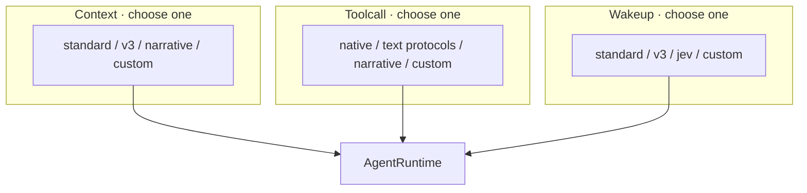
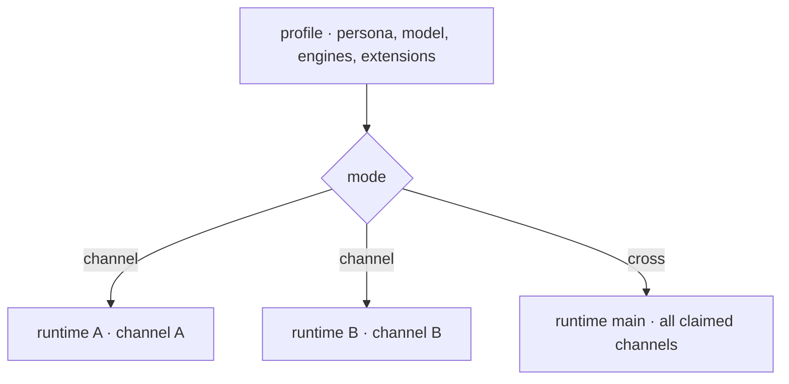

<picture>
  <source media="(prefers-color-scheme: dark)" srcset="docs/public/logo.en-dark.svg">
  
</picture>

[中文](README.md) · [Documentation](https://ishiki.js.org/docs/) · [Quick start](https://ishiki.js.org/docs/tutorial/quickstart/) · [Core runtime](packages/koishi-plugin-ishiki/README.en.md)

Ishiki is a **Bot development meta-framework for building autonomous Agents**. It separates context construction, model interaction, and execution timing into three replaceable engine families, alongside programmable tool use, on-demand discovery, unified resource access, and multi-instance operation.

The name comes from the Japanese word _ishiki_ (意識), meaning consciousness or awareness. We want AI to develop a sense of presence through ongoing memory, action, and interaction. Ishiki provides components and concepts that give developers room to concentrate on their creations. Give consciousness a form. Let every Agent find its own character.

## Shape your Agent

What an Agent sees, how its model works, and when it runs are three concerns developers can design separately.

### Context · What the model sees

The context engine retrieves, selects, and organizes information into the `messages` required by a model request. Linear history, structured state, memory retrieval, and an evolving script can all use this extension point.

Original events and tool records remain in the session log. The engine controls their presentation and can maintain its own summaries and memory.

### Toolcall · How a model interaction works

The toolcall engine defines the interaction between model output and tool calls. It can parse text-based tool protocols or wrap `LanguageModelV4` with middleware, coordinating multiple inference calls, models, and roles inside one host invocation before returning a standard model result.

### Wakeup · When the Agent runs

The wakeup engine controls execution timing. Input ingestion and scheduling are independent: events can inform a decision, while an engine can also keep timers, schedule another turn, and establish an autonomous rhythm without external input.

Each implementation chooses its triggers, frequency, and scheduling policy. Built-in engines provide rules, response willingness, and model-based decisions; custom engines can arrange ongoing autonomous operation.

### One variant per engine family

Ishiki builds on [yesimagent](https://github.com/YesWeAreBot/yesimagent), a lightweight, extensible Agent runtime whose `AgentPlugin` interface exposes control throughout the loop. Ishiki organizes its main behavioral customization points into **mutually exclusive engine families**, giving each concern a clear owner.

The system can register multiple variants. Each runtime selects one variant in each family. Developers can add variants and provide cooperating engines where a design requires an explicit contract.

[Explore engine design and extension APIs →](https://ishiki.js.org/docs/explanations/engines/)

## What can happen inside one model invocation?

[narrative](packages/narrative/README.md) demonstrates a story-driven model interaction:

- A **Narrator** extends the script from its existing story and new events, then chooses an intent.
- For an action, an **Action Decoder** translates that intent into a standard tool call.
- For a reply, a **Replyer** writes the actual message.

The Narrative ContextEngine maintains each runtime's narrative context. The Narrative ToolcallEngine coordinates these stages within a model invocation. The host receives a standard `LanguageModelV4` result and continues to own tool execution and session storage.

This standalone plugin implements its narrative behavior through two cooperating engines, using the same engine interfaces as the rest of the runtime.

## Organize actions with code

Ishiki brings **programmable tools, on-demand discovery, and resource references** into one workflow.

### codemode · Put tools in a program

The model can write a program that combines tools, processes results, and passes intermediate data inside a QuickJS sandbox. Business tools become callable through the same `codemode` entry point as capabilities grow.

`send_message` supports both direct and programmatic calls. `finish` and `wait` remain directly callable; the `direct` setting can retain other tools on the direct model interface.

### toolsearch · Discover capabilities as needed

When toolsearch is enabled, non-resident tools enter a deferred pool. The model uses `search` to find tools by name and description. Matches become available from the next step, and catalog updates are incremental by default.

Together with codemode, this lets capability growth and the number of top-level tool choices be managed separately.

### Resource URLs · Give data an address

Images, files, tool outputs, and external resources can be referenced through URLs such as `asset://`, `artifact://`, `workspace://`, and `mcp://`, then read through a single `read` tool.

The model can carry compact references through its work. Programs read the actual data and pass text or media according to each receiving tool's input contract. The resource system manages long image URLs and large payloads.

An extension can implement a `SchemeHandler` to add another resource source through the existing `read` interface. For example, registering HTTP(S) handlers would enable network reads. Resources resolve within their runtime's resource center, and each handler determines its access scope.

codemode and toolsearch are configured per profile and are disabled by default. See [tool calls and resources](https://ishiki.js.org/docs/explanations/tools-pipeline/) for configuration and a data-processing example.

## Many identities, or one familiar character

A **profile declares a stable persona and is the basic unit of multi-instance deployment**. It selects models and engines, claims accounts and channels through `channels`, and enables its own extensions through `extends`.

One persona can accumulate separate experiences in each channel, or share context across accounts and channels.

- **channel** creates an independent runtime for each channel on demand, with its own session log, resources, and context.
- **cross** uses one runtime for the profile. All claimed channels share its context, and outgoing messages specify a target channel.

Multiple profiles can run together with their own identities and capabilities. Their channel claims must be configured without overlap.

[Write a profile →](https://ishiki.js.org/docs/guides/profile/) · [Understand instances and sharing →](https://ishiki.js.org/docs/explanations/profiles-runtimes/)

## Get started

[`koishi-plugin-ishiki`](packages/koishi-plugin-ishiki/README.en.md) is the current Koishi-based core runtime. It connects to chat platforms through Koishi adapters.

The plugin is available in the Koishi plugin market. Search for `koishi-plugin-ishiki` in the console, add and install it, then enable it under plugin configuration. On first start with an empty data directory, the plugin releases a preset. Fill in the model API key and the bot's `platform:selfId` in the `Ishiki` console, apply the default profile, and start a conversation in a claimed channel.

- [Core runtime README](packages/koishi-plugin-ishiki/README.en.md): installation and minimal configuration.
- [Quick start](https://ishiki.js.org/docs/tutorial/quickstart/): plugin market installation through the first conversation.
- [Extension API](https://ishiki.js.org/docs/reference/api/): tools, engines, and resource handlers.

The documentation site is currently in Chinese.

Ishiki's design centers on the Agent itself. A future goal is to offer operation independent of Koishi, bringing these components and concepts to a broader range of hosts.

## Ecosystem and participation

| Package                                                                          | Capabilities                                              |
| -------------------------------------------------------------------------------- | --------------------------------------------------------- |
| [`koishi-plugin-ishiki`](packages/koishi-plugin-ishiki/README.en.md)             | Core runtime, engines, profiles, tools, and resources     |
| [`koishi-plugin-ishiki-workspace`](https://ishiki.js.org/docs/guides/workspace/) | Workspace, file operations, command execution, and skills |
| [`koishi-plugin-ishiki-mcp-client`](https://ishiki.js.org/docs/guides/mcp/)      | MCP tools and resources                                   |
| [`koishi-plugin-ishiki-narrative`](packages/narrative/README.md)                 | Narrative context and multi-role model interaction        |
| [`koishi-plugin-ishiki-onebot-actions`](packages/onebot-actions/README.en.md)    | OneBot action catalogs and protocol-specific operations   |

Share your experience and design ideas through [Issues](https://github.com/YesWeAreBot/ishiki/issues), or contribute a pull request. The [maintenance guide](https://ishiki.js.org/docs/dev/maintenance/) covers builds and documentation workflows. QQ group: [857518324](https://qm.qq.com/q/EeL0FDu3JK).

Ishiki is developed by [Yes! We Are Bot!](https://github.com/YesWeAreBot) and licensed under [MIT](LICENSE).
