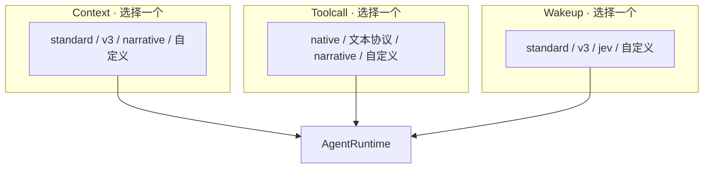
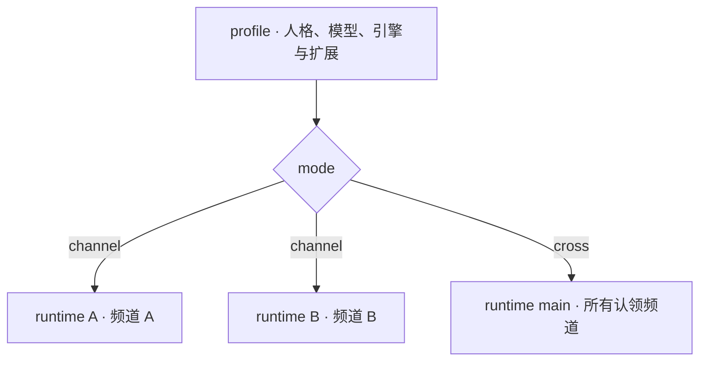

<picture>
  <source media="(prefers-color-scheme: dark)" srcset="docs/public/logo-dark.svg">
  
</picture>

[文档](https://ishiki.js.org/docs/) · [快速开始](https://ishiki.js.org/docs/tutorial/quickstart/) · [核心运行时](packages/koishi-plugin-ishiki/README.md) · [English](README.en.md)

Ishiki 是一个用于构建自主 Agent 的 **Bot 开发元框架**。它将上下文组织、模型交互与运行节律抽象为三组可替换引擎，并提供工具编程、按需发现、统一资源访问与多实例运行能力，让开发者自由塑造自己的 Agent。

名字取自日语「意識（いしき）」，意为意识、自觉。我们期待 AI 在持续的记忆、行动与交互中，逐渐拥有自己的存在方式；Ishiki 为这样的创作提供组件与概念，让开发者能够把精力放在作品本身。为意识赋形，让 Agent 自成一格。

## 塑造你的 Agent

上下文如何组织、模型如何行动、Agent 何时运行，是三个可以分别设计的关注点。

### Context · 模型能够看到什么

上下文引擎负责检索、筛选和组织模型需要的信息，组装模型请求的 `messages`。线性历史、结构化状态、记忆检索、持续发展的剧本，都可以通过这一入口表达。

原始事件与工具记录保存在会话日志中。引擎决定如何把它们呈现给模型，也可以组织自己的摘要与记忆。

### Toolcall · 一次模型交互如何完成

工具调用引擎定义模型输出与工具调用的交互方式。它可以解析文本工具协议，也可以通过中间件包装 `LanguageModelV4`，在一次宿主调用内部协调多次推理、多个模型与不同角色，最终交回标准模型结果。

### Wakeup · Agent 何时运行

唤醒引擎掌握 Agent 的运行时机。事件输入与运行调度相互独立：事件可以成为判断依据，引擎也可以自行计时、安排下一轮，在没有外部输入的情况下维持自主节律。

触发条件、运行频率与调度策略由具体引擎决定。内置引擎提供规则、响应意愿与模型判定等策略，自定义引擎可以进一步组织持续的自主运行。

### 每个引擎族，选择一个变体



Ishiki 基于 [yesimagent](https://github.com/YesWeAreBot/yesimagent) 构建。这个轻量、可扩展的 Agent 运行时通过 `AgentPlugin` 提供丰富的循环控制接口；Ishiki 将主要的行为定制组织成三个**同族互斥**的引擎族，让每项行为都有明确的负责者。

系统可以注册多个变体，每个 runtime 在每个族中选择一个。开发者可以增加新的引擎变体，也可以为明确的协作关系提供配套引擎。

[了解引擎设计与扩展接口 →](https://ishiki.js.org/docs/explanations/engines/)

## 一次模型调用，可以有怎样的内部世界？

[narrative](packages/narrative/README.zh-CN.md) 展示了一种叙事驱动的模型交互：

- **Narrator** 根据已有剧本与新增事件续写，决定下一步意图。
- 需要行动时，**Action Decoder** 把意图转换为标准工具调用。
- 需要表达时，**Replyer** 写出实际回复。

Narrative ContextEngine 维护每个 runtime 的叙事上下文，Narrative ToolcallEngine 在模型调用内部协调这些阶段。外部依然收到标准的 `LanguageModelV4` 结果，工具执行与会话存储继续使用 Ishiki 的运行机制。

这个独立插件通过两个配套引擎实现了整套叙事能力。核心运行时始终使用相同的引擎接口。

## 用程序组织行动

Ishiki 把**工具编程、按需发现与资源引用**放在同一条工作路径上。

### codemode · 把工具写进程序

模型可以编写一段程序，在 QuickJS 沙箱中组合工具、处理结果并传递中间数据。业务工具通过程序调用，新增能力可以继续进入同一个 `codemode` 入口。

`send_message` 保留直接调用与程序调用两种入口，`finish`、`wait` 保持直接调用；需要额外直接暴露的工具可以通过 `direct` 配置。

### toolsearch · 需要时，再发现

启用 toolsearch 后，非常驻工具进入待发现的工具池。模型通过 `search` 按名称与描述寻找能力，命中的工具从下一步开始可用，工具目录默认采用增量更新。

它与 codemode 配合，让能力增长与顶层工具选择数量分别管理。

### 资源 URL · 数据有自己的地址

图片、文件、工具输出与外部资源，可以通过 `asset://`、`artifact://`、`workspace://`、`mcp://` 等 URL 引用，再交给统一的 `read` 读取。

模型可以携带简短的资源引用继续工作；程序读取实际数据后，可以按其他工具的输入要求传递文本或媒体。长图片链接与大段原始数据由资源系统管理。

扩展实现 `SchemeHandler` 后，便可以通过已有的 `read` 增加资源来源。例如，注册 HTTP(S) handler 可以让 `read` 读取网络内容。资源在所属 runtime 的资源中心解析，具体访问范围由 handler 决定。

codemode 与 toolsearch 均按 profile 启用，默认关闭。完整的配置与数据处理示例见[工具调用与资源流程](https://ishiki.js.org/docs/explanations/tools-pipeline/)。

## 千人千面，或如出一辙

**profile 声明稳定人格，也是多实例部署的基本单位。** 每份 profile 选择模型与引擎，通过 `channels` 声明接管的账号和频道，通过 `extends` 启用自己的扩展。

同一份人格可以按频道分别积累经历，也可以在多个账号与频道之间保持共享的上下文。



- **channel**：每个频道按需创建独立 runtime，分别维护会话日志、资源与上下文。
- **cross**：一个 profile 使用一个 runtime，所有认领频道进入同一份会话上下文，发送消息时显式指定目标频道。

多个 profile 可以同时运行，各自拥有身份与能力。它们接管的频道需要分别配置，避免认领范围重叠。

[编写 profile →](https://ishiki.js.org/docs/guides/profile/) · [理解实例与共享范围 →](https://ishiki.js.org/docs/explanations/profiles-runtimes/)

## 开始构建

[`koishi-plugin-ishiki`](packages/koishi-plugin-ishiki/README.md) 是当前基于 Koishi 的核心运行时，使用 Koishi 适配器连接聊天平台。

准备好 Koishi 应用、平台适配器与模型接口后，从源码构建：

```bash
git clone https://github.com/YesWeAreBot/ishiki.git
cd ishiki
bun install
bun run build
```

随后链接核心插件，填写 `models.yaml`，创建第一份 `profile.yml` 与它引用的指令文件：

- [核心运行时 README](packages/koishi-plugin-ishiki/README.md)：安装与最小配置。
- [快速上手](https://ishiki.js.org/docs/tutorial/quickstart/)：从源码接入到第一次对话。
- [扩展 API](https://ishiki.js.org/docs/reference/api/)：编写工具、引擎和资源 handler。

Ishiki 的设计围绕 Agent 本身展开。未来希望进一步提供独立于 Koishi 的运行方式，让这些组件与概念服务于更广泛的宿主环境。

## 生态与参与

| 包                                                                               | 能力                                      |
| -------------------------------------------------------------------------------- | ----------------------------------------- |
| [`koishi-plugin-ishiki`](packages/koishi-plugin-ishiki/README.md)                | 核心运行时、引擎、profile、工具与资源机制 |
| [`koishi-plugin-ishiki-workspace`](https://ishiki.js.org/docs/guides/workspace/) | 工作区、文件操作、命令执行与技能          |
| [`koishi-plugin-ishiki-mcp-client`](https://ishiki.js.org/docs/guides/mcp/)      | MCP 工具与资源接入                        |
| [`koishi-plugin-ishiki-narrative`](packages/narrative/README.zh-CN.md)           | 叙事上下文与多角色模型交互                |
| [`koishi-plugin-ishiki-onebot`](packages/onebot/README.zh-CN.md)                 | OneBot 动作目录与协议特有操作             |

欢迎通过 [Issues](https://github.com/YesWeAreBot/ishiki/issues) 分享使用体验与设计想法，或提交 Pull Request 参与开发。构建与文档工作流见[维护手册](https://ishiki.js.org/docs/dev/maintenance/)。

Ishiki 由 [Yes! We Are Bot!](https://github.com/YesWeAreBot) 开发，采用 [MIT 许可证](LICENSE)。
