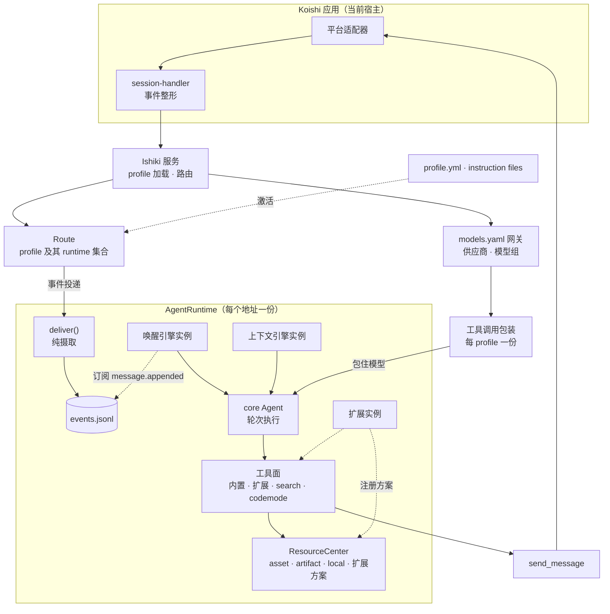

## 两层结构

Ishiki 的运行建立在 `yesimagent` 之上。`@yesimagent/core` 提供 Agent 的核心循环：轮次、事实日志、AgentPlugin 钩子、工具与消息类型、`LanguageModelV4` 模型接口。`@yesimagent/gateway` 读取 `models.yaml`，把供应商与模型组解析成模型入口，并按候选顺序与熔断状态提供可尝试的模型。两者都不包含 Koishi 与平台相关代码。

`koishi-plugin-ishiki` 负责把这两组原语装配成可配置的角色运行环境：

- 从 `profiles/<目录>/profile.yml` 读取并校验声明，编译频道认领；
- 为每个 profile 建立一条 Koishi fiber，按需派生 runtime；
- 按 profile 的三段配置解析引擎服务，产出各 runtime 的上下文与唤醒实例，以及 profile 级共享的工具调用包装；
- 装配扩展、内置工具与每个 runtime 的资源中心；
- 把 Koishi 会话整形成 `IshikiEvent`，路由到对应 runtime。

core 暴露的 AgentPlugin 接口很宽，包含决策与改写两类钩子。Ishiki 在自己的 runtime 内部使用这些钩子；面向扩展只保留工具、提示词两项加法与生命周期挂载。扩展因此无法改写轮次内部的钩子、上下文投影或工具执行顺序。

## 输入与调度

输入到达与开始一轮是两件事。

Koishi 的 `internal/session` 事件由 `session-handler` 整形为 `ishiki.message.created` 或 `ishiki.message.deleted`，再按账号与频道找到 route，进入对应 runtime 的 `deliver(event)`。`deliver` 只做摄取：捕获平台附件，然后 `agent.send(event, { trigger: false, ifBusy: "join" })`。它不做判定，也不开启轮次。调用返回表示事件已交给 Agent；写入事实日志由存储层异步完成，提交完成的信号是 `message.appended` 通知。如果某一轮正在运行，新输入会并入该轮，并在这一步的输出批次之后一起提交。

唤醒引擎可以订阅 `message.appended`，从已提交的消息中选择调度依据，也可以自行维护定时器与运行计划，调用 `agent.continue()` 开始一轮。内置的 standard、v3、jev 都在消息提交之后做判定；事件记录与这些判定分别进行。

唤醒还有两条不经过引擎的来路：

- `runtime.wake(prompt?)` 直接调用 `agent.continue(prompt)`，供扩展的定时器与主动消息使用；
- 模型调用 `wait` 声明下一次唤醒条件（新增消息条数或经过的秒数），条件满足后由 runtime 的等待机触发一轮。

「在没有外部输入时持续运行」由唤醒接口支持：实例可以自行安排定时器，也可以在没有新消息时调用 `continue`。内置变体没有默认开启这种自驱动，需要自定义唤醒引擎实现。`wait` 是一次性声明，触发后即消耗。

## 三族引擎

一次模型调用涉及三个互不相同的关注点：

| 引擎族 | 关注点 | 实例接口 |
| --- | --- | --- |
| 上下文（context） | 把历史事实投影成这一轮的模型输入 | `prepareEntries`、`renderMessages`、`instructions` |
| 唤醒（wakeup） | 决定何时开始一轮 | `attach(agent)` |
| 工具调用（toolcall） | 组织模型内部交互并生成标准结果 | `middleware()` 包装 `LanguageModelV4` |

三个关注点可以分别定制，同一个 runtime 在每族中选择一个变体。唤醒引擎安排运行时机，上下文引擎在请求前整理输入，工具调用引擎在模型调用内部组织交互。具体变体按各自接口约定协作。

上下文引擎不修改已有事实。压缩类操作用追加新条目的方式表达，历史保持可回放；它可以追加系统提示词。唤醒引擎的 `attach` 是必选成员，用于建立订阅、定时器或其他调度机制，并返回释放函数。这些状态跟着实例走，channel 模式下各频道天然隔离。工具调用引擎包装 `LanguageModelV4`：`native` 的 `middleware()` 返回 `undefined`，直接使用模型的原生 function call；文本协议变体把 JSON、XML 等输出解析成工具调用；`narrative` 在同一个模型步骤内组织多个模型调用，返回标准的 `LanguageModelV4` 结果。无论哪种变体，真正的工具执行都由宿主 Agent 完成。

`narrative` 由独立插件提供，上下文与工具调用两个变体配套使用：上下文引擎维护可恢复的叙事，工具调用引擎在同一个模型步骤里推进 Narrator。Narrator 选择下一步意图，行动意图交给 Action Decoder 生成宿主工具调用，回复意图交给 Replyer 写出实际消息。两个分支按意图选择；工具执行与会话存储由宿主负责。

### 变体按服务发现

每个引擎变体是一个 Koishi Service，名字由基类的 `GetName` 生成：`ishiki.engine.context.standard`、`ishiki.engine.wakeup.jev`、`ishiki.engine.toolcall.native`……内置变体在主插件构造时注册；第三方变体作为普通 Koishi 插件安装，注册同名服务即可被发现。

profile 激活时，主插件从三段配置里收集服务名，连同 `extends` 的扩展服务一起，作为 `ctx.inject` 的依赖表。服务齐全后执行装配：

- `ContextEngine.GetService(fiber, name)` 与 `WakeupEngine.GetService(fiber, name)` 取出 provider，对每个 runtime 调用 `[Service.invoke](配置, ExtensionContext)`，得到该实例的引擎实例；
- `ToolcallEngine.GetService(fiber, name)` 取出 provider，在 profile 装配期调用一次，用返回的包装器包住模型。

由此得到状态归属：上下文与唤醒的会话状态按 runtime 隔离；工具调用包装与模型按 profile 共享，包装器里不能放某个会话的状态。任何一个必需服务缺席，profile 记录一条错误并停在等待态，其他 profile 继续运行。

## profile、route 与 runtime

- **profile**：`profiles/<目录>/profile.yml`（也接受 `.yaml`）加 `instructions` 引用的文件。`resolveProfile` 完成 Schema 校验、频道匹配器编译、`enable: false` 扩展剔除。坏掉的目录只跳过它自己。
- **route**：内存里的 `{ profile, runtimes, spawn }`，表示一个 profile 及其全部实例。消息按 `sid = platform:selfId` 找候选 route，再用频道认领名单选出唯一所有者。
- **runtime**：一个地址上的运行态，key 为 `profile/sid/channel`，cross 模式为 `profile/main`。它持有 core Agent、JSONL 事实日志、资源中心、上下文与唤醒实例、扩展实例。

频道认领在装配期决定：profile 的 `channels` 编译成包含项与排除项，两个 profile 认领重叠时后加载者被整体跳过。认领名单同时是模型可达集的依据。

channel 模式为每个频道派生独立 runtime，历史与资源互不相通，`send_message` 直接发到当前频道。cross 模式把认领的频道合流为一个 runtime，共享上下文与事实日志；消息在事实流里带频道坐标，`send_message` 要求 `target: { sid, channelId }`，并用同一份认领名单校验。runtime 按需创建：常见时机是第一条落到该地址的输入；创建后，后续输入与显式唤醒复用同一实例。

扩展按 profile 的 `extends.<包名>` 装配。每个包导出 `Extension` 子类，由自己的插件入口注册为 `ishiki.ext.<名字>`；主插件在 runtime 构造前调用 `[Service.invoke](配置, ExtensionContext)`，得到 `ExtensionInstance`。实例的 `extendTools` 与 `extendInstructions` 由内核每轮调用一次，`attach` 在 runtime 构造完成后执行，`stop` 与 `attach` 返回的释放函数在 runtime 停止时执行。扩展服务的注册与生命周期归它自己的插件作用域。

## 工具面与资源

工具面与提示词都按轮组装，装配期不冻结：

- 工具面 = 内核工具（`read`、`send_message`、`finish`）+ 各扩展按 `extends` 顺序贡献的工具 + `wait` + codemode 的 `codemode` 工具（开启时）+ toolsearch 的 `search` 工具（开启时）。工具重名抛出 `ToolConflictError`；每轮组装时的错误进入该轮次的失败处理。toolsearch 初始化还会组装一次工具集并保存初始目录。
- 提示词 = 内核段落（persona、控制流、已启用能力的说明）+ 扩展贡献的提示词 + 上下文引擎的 `instructions()`。需要跨轮稳定的内容由扩展自己在闭包里缓存。

`codemode` 与 `toolsearch` 默认关闭。

`codemode` 开启后，多数业务工具收进 QuickJS，模型写一段程序，用 `await tools.name(input)` 组合调用。`finish` 与 `wait` 保持直调，`send_message` 在直调与程序两侧都可达，`direct` 列表里的工具额外保留直调。程序内部只执行工具，不经过模型的输出转换；需要带到下一步的数据由程序最终 `return`。

`toolsearch` 开启后，非常驻工具延迟披露。模型调用 `search` 后，命中的工具从下一步开始可调用；工具目录默认增量更新。与 codemode 配合时，程序内部可用的工具不必逐个进入顶层模型选择。

每个 runtime 拥有独立的 `ResourceCenter`。`asset`、`artifact`、`local` 是内置方案；workspace、skill、mcp、onebot 由扩展注册。方案处理器接收完整 URL，自行解释路径、查询参数与视图；`read` 统一从资源中心读取，不需要认识每种来源。URL 在对应 runtime 的资源中心解析，同一字符串在不同 runtime 或部署之间不保证指向相同内容。工具按各自输入契约接受 URL 或实际字节，系统不会自动重写任意工具入参。HTTP(S) 方案可以作为扩展实现，当前没有内置。

## 模块依赖

图中的几条边界：

- 平台差异集中在边缘：`session-handler` 负责入站整形，附件捕获把媒体元素登记为资源，`send_message` 负责出站渲染与发送。路由、上下文与工具执行只处理整形后的事实。
- `Ishiki` 服务持有 profile 加载、路由表与模型网关；profile 的激活、服务和扩展的解析由 `ctx.inject` 门控。
- `AgentRuntime` 是资源、事实日志与引擎实例的归属点。扩展挂到 runtime 上，贡献工具、提示词或资源方案。
- 模型在 profile 级共享：`narrative` 这类工具调用包装只创建一次，运行时按实例传入各自的上下文与唤醒实例。

## 当前形态与独立运行

当前仓库唯一的宿主是 `koishi-plugin-ishiki`：profile 激活依赖 Koishi fiber，引擎与扩展以 Koishi Service 注册，输入来自 Koishi 会话，发送走 Koishi 适配器。

`@yesimagent/core` 与 `@yesimagent/gateway` 本身不依赖 Koishi。独立于 Koishi 的运行方式是项目的发展方向；现有 provider 基类与 `ExtensionContext` 仍使用 Koishi 的服务和生命周期机制。

## 术语表

| 术语 | 含义 |
| --- | --- |
| profile | 一份 `profile.yml`：人格、模型、频道认领、三族引擎与扩展的选择 |
| runtime | 一个地址上的运行实例：独立事实日志、资源目录、上下文与唤醒实例 |
| route | 一个 profile 及其全部 runtime 的内存集合，按账号与频道匹配 |
| 引擎族 | 上下文、唤醒、工具调用三类可替换组件；同族互斥，每族选一个变体 |
| 扩展 | 按 profile 装配的包，贡献工具与提示词，可注册资源方案 |
| 事实日志 | 实例的 `events.jsonl`；历史投影的唯一事实来源 |
| 工具面 | 每轮组装出的工具集合：内核、扩展、`wait`、codemode 与 toolsearch |
| 资源中心 | 每个 runtime 一份，按 scheme 路由完整 URL |
| instructions | `profile.yml` 中声明的文件列表，内容按声明顺序注入内核提示词末尾 |

## 继续阅读

<Cards>
  <Card
    title="profile 与 runtime"
    description="派生规则、channel 与 cross 的取舍、认领边界"
    href="/docs/explanations/profiles-runtimes"
  />
  <Card
    title="引擎系统"
    description="三族引擎的约束、变体清单与自定义引擎"
    href="/docs/explanations/engines"
  />
  <Card
    title="一次工具调用的旅程"
    description="从模型输出到结果回流、资源固化与附件投影"
    href="/docs/explanations/tools-pipeline"
  />
</Cards>
