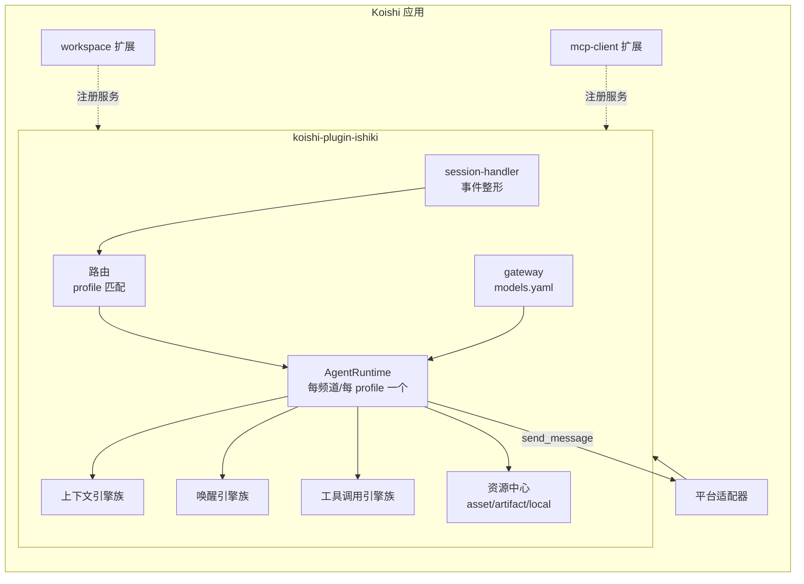

这份解析回答「Ishiki 为什么是现在这个样子」：它的核心思想、与前身的关系、模块如何分界。具体机制在参考分区，本文只讲理解。

## 核心思想：事件驱动的大脑

Ishiki 的世界观建立在三个命题上：

**1. 意识是间歇的。** Bot 的大脑不是常驻进程——没有消息事件时它不存在。每次事件（有人说话、有人撤回、其他频道有动静）把它「唤醒」一次，处理完即沉寂。这决定了它的成本模型：空闲零开销，活跃时按事件计费。

**2. 说话是决策的结果。** 从「消息到达」到「发出消息」之间隔着两层决策：唤醒引擎决定「理不理」，模型决定「说不说、说什么」。模型的普通文本输出是内心独白，只有 `send_message` 到达平台。把「想」和「说」分开，让沉默成为零成本的自然选择，也让内心戏成为人格连续性的载体。

**3. 感知是投影。** 模型每轮看到的不是原始数据库，而是投影：上下文引擎整理历史，附件策略按配额投放图片，工具结果被截断归档。这层「知觉」是可配置的——它就是上下文引擎与附件系统的职责。

这三个命题合起来，解释了配置面的形状：唤醒/上下文/工具调用三族引擎，正好对应「理不理」「看什么」「怎么做」三个正交的关注点。

## 从 YesImBot 到 Ishiki

Ishiki 是 YesImBot（Athena）设计思想的延续。前者的核心资产——事件化对话、响应意愿（v3 唤醒引擎的前身）、WorldState 上下文、工具协议——以引擎的形式在 Ishiki 中获得第二生命，这也是三个引擎里都有 `v3` 变体的原因：它们是迁移通道。

架构上的主要差异：

| | YesImBot v4 | Ishiki |
| --- | --- | --- |
| 定位 | 完整产品（含 Launcher、控制台、数据库） | 纯插件，只做大脑 |
| 平台接入 | 自建 PlatformTranslator 层 | 直接用 Koishi 原生适配器 |
| 模型接入 | Provider 插件体系 | 声明式 `models.yaml` 网关 |
| 配置 | Koishi 控制台表单为主 | 文件优先（profile YAML），可版本管理 |

「机器壳，人类心」的目标一脉相承，但 Ishiki 把自己收缩为一个更纯粹的组件：它不管理机器人，只提供「一个 profile = 一个活着的角色」的运行时。

## 模块边界

几个刻意的边界：

<Callout title="能力面与行为面分离">
扩展只能贡献工具与提示词。这是防蔓延的边界：改变「理不理」请写唤醒引擎，改变「看什么」请写上下文引擎。
</Callout>

- **主插件不含任何具体平台逻辑**。频道、消息元素、发消息都走 Koishi 原生抽象；换来的是任何 Koishi 适配器（OneBot/Discord/Telegram…）零成本接入。
- **模型接入只有一个入口**。`models.yaml` 声明一切，profile 只写引用；没有 per-profile 的密钥、没有运行时发现。
- **每个实例的资源互不可见**。资源中心按实例隔离，`local://` 不能越出实例目录；多账号共享一个 profile 时（cross 模式）共享的是同一实例，也就共享全部资源。

## 术语表

| 术语 | 含义 |
| --- | --- |
| profile | 生效单位：认领频道、选模型、配引擎；目录在 `profiles/<ID>/` |
| runtime（实例） | profile 在一个频道（或 cross 全体）上的运行态：独立记忆、独立资源 |
| route | 一个 profile 及其派生的全部 runtime，频道匹配的中间层 |
| 引擎（engine） | 三族可替换组件：上下文/唤醒/工具调用 |
| 扩展（extension） | 外部贡献包：工具 + 提示词（workspace、mcp-client） |
| 事实流（事实日志） | 实例的 `events.jsonl`，历史投影的唯一事实源 |
| persona | 人设文件，注入系统提示词的 `<persona>` 身份 |

## 继续阅读

<Cards>
  <Card
    title="profile 与 runtime"
    description="生效单位与意识实例的关系，channel / cross 两种派生方式"
    href="/docs/explanations/profiles-runtimes"
  />
  <Card
    title="三个引擎族"
    description="为什么把「理不理」「看什么」「怎么做」做成可替换组件"
    href="/docs/explanations/engines"
  />
  <Card
    title="一次工具调用的旅程"
    description="从模型输出到结果回流，中间那条流水线"
    href="/docs/explanations/tools-pipeline"
  />
</Cards>
