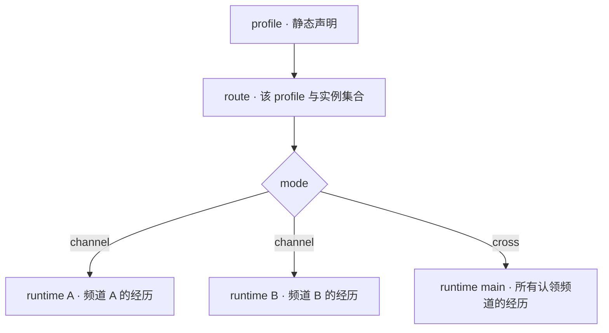

同一份人格可以在不同频道分别积累经历，也可以共享多个账号与频道中的上下文。Ishiki 通过 profile 声明身份与能力，通过 runtime 承载实际运行状态。

## profile：稳定人格的声明

每个 profile 位于 `profiles/<目录名>/`，由 `profile.yml` 或 `profile.yaml`、`instructions` 引用的文件及附属文件组成。它声明：

- **身份**：人格与系统提示词。
- **活动范围**：`channels` 中认领的账号、频道与排除项。
- **行为**：模型选择，以及 context、toolcall、wakeup 三族引擎的变体和配置。
- **能力**：通过 `extends` 启用的扩展与专属配置。
- **实例组织**：`mode` 选择按频道隔离，或跨频道共享。

profile 也是激活与依赖隔离的单位。缺少它需要的引擎或扩展服务时，该 profile 等待依赖；其他具备依赖的 profile 继续运行。

## runtime：独立经历的承载者

runtime 持有一个实际的 Agent，包括自己的会话日志 `events.jsonl`、资源中心、上下文引擎实例、唤醒引擎实例和扩展实例。runtime 按需创建，路由到某个认领频道的首次输入会创建对应实例。

同一 profile 派生的 runtime 共享人格声明、模型与 Toolcall 包装器。会话状态由各自的日志与 Context/Wakeup 实例维护，Toolcall 包装器根据每次传入的模型请求工作。



route 是内存中的路由记录，包含 profile 与它派生的 runtime 集合。输入先通过账号和频道认领匹配到 route，再进入相应 runtime。

## channel：每个频道，分别积累经历

`channel` 是默认模式，每个认领频道拥有独立 runtime：

- 各频道使用独立会话日志与上下文。
- Context、Wakeup 和扩展实例按 runtime 分别创建。
- 资源中心与实例工作目录按频道分别管理。
- `send_message` 直接发送到实例所属频道，工具参数中没有 `target`。

多个 runtime 使用同一份人格配置，可以保持相同的表达习惯与能力，同时各自发展对话历史。

实例目录为 `runtimes/<账号标识>/<频道标识>/`，其中不适合作为文件名的字符会被替换。

## cross：多个频道，共享一份上下文

`cross` 模式为整个 profile 使用一个 runtime：

- 所有认领账号和频道的输入写入同一份会话日志。
- 同一个 Agent 处理这些输入，分享上下文、资源与扩展实例状态。
- 频道来源作为坐标保留在上下文中。
- 实例目录固定为 `runtimes/main/`。

所有频道共用同一个模型上下文预算。选择认领范围时，需要一起考虑输入总量、上下文引擎的保留策略与模型调用成本。

<Callout title="跨频道发送需要明确目标">
`send_message` 在 cross 模式下要求 `target: { sid, channelId }`。每条频道事实的寻址头会提供对应坐标，Agent 可以据此选择目标；目标必须属于 profile 的认领范围，包括当前没有新输入的已认领频道。
</Callout>

## 从配置到实例

profile 加载与运行分成以下步骤：

1. **解析与认领检查**：校验 YAML，将频道规则编译为包含项和排除项，检查 profile 之间的重叠。配置损坏或认领冲突只跳过相关 profile。
2. **等待依赖**：根据三组引擎名称与启用的 `extends` 收集所需 Koishi Service。缺少服务时记录错误并等待；服务可用后继续激活。
3. **激活 profile**：解析模型引用与 Toolcall 包装器，获取 Context/Wakeup provider 与扩展服务，读取人格，校验图片能力和扩展配置，建立 route。
4. **按需创建 runtime**：创建实例目录与资源中心，分别调用 Context/Wakeup provider 和扩展服务，构造 AgentRuntime 并挂载实例生命周期。
5. **每轮组织输入与能力**：Context 引擎准备模型输入，内核收集扩展的工具和提示词，再应用 codemode、toolsearch 与附件策略。

工具与提示词在轮次中重新收集。工具撞名等组装错误因此进入该轮次的失败处理。启用 toolsearch 时，初始化还会组装一次工具集并保存初始目录。

profile 配置与指令文件在激活时读取。修改后需要重新加载插件。profile 所需服务被卸载时，对应 route 被移除，已有 runtime 停止；依赖恢复后重新激活，并在后续输入到来时创建实例。

## 为多个 profile 分配频道

`channels` 是加载时确定的认领范围。每个账号和频道组合应归属一个 profile；发生重叠时，后加载的 profile 会被跳过。

例如，一个 profile 管理账号的大部分频道，另一个 profile 专门管理某个频道：

```yaml
# profiles/main/profile.yml
channels:
  "onebot:BOT_ID": ["*", "!CHANNEL_ID"]
```

```yaml
# profiles/work/profile.yml
channels:
  "onebot:BOT_ID": ["CHANNEL_ID"]
```

这些片段分别合并到已有 profile 中；两份 profile 仍各自需要 `model`。排除项让认领范围互不重叠，实例共享方式继续由每份 profile 的 `mode` 决定。

资源 URL 在所属 runtime 的资源中心解析。扩展显式连接同一外部数据源或挂载共享目录时，数据共享范围由该扩展与挂载配置决定。

## 继续阅读

<Cards>
  <Card title="编写 profile" description="账号、频道模式、排除项与指令文件" href="/docs/guides/profile" />
  <Card title="引擎系统" description="选择上下文、模型交互与运行调度的实现" href="/docs/explanations/engines" />
  <Card title="扩展 API 参考" description="引擎、工具与资源的实例契约" href="/docs/reference/api" />
</Cards>
