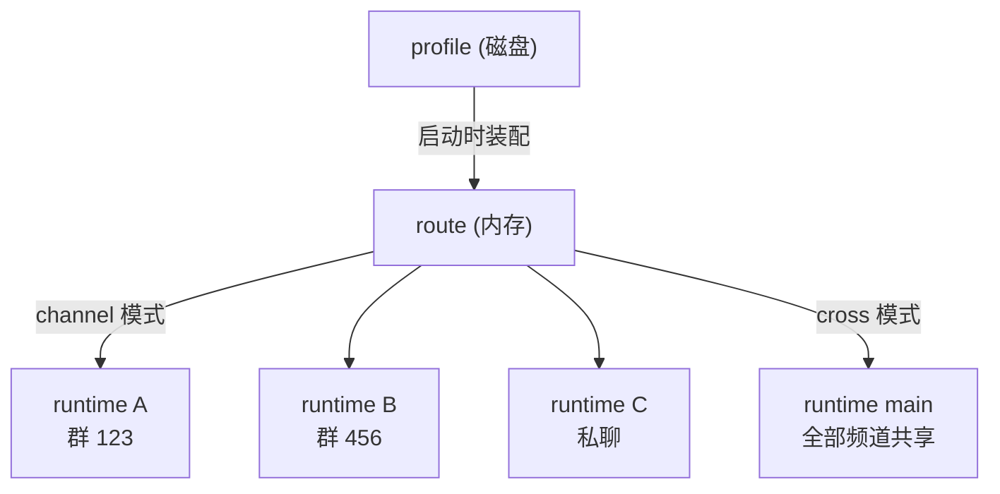

「写一份 YAML，bot 就活了」——本文拆开这句话：profile 是静态配置，runtime 是活着的实例，两者之间隔着一条装配流水线。理解这条流水线，才能解释很多「为什么」（为什么改配置要重启、为什么频道会冲突、为什么 cross 模式说话要带坐标）。

## 三个概念

**profile** 是磁盘上的静态声明：`profiles/<目录名>/profile.yml` 加 `persona.md` 等附属文件。它回答「这个角色是谁、在哪里活动、用什么引擎」。插件启动时全部加载。

**route（路由）** 是内存中「一个 profile + 它派生的全部 runtime」的容器。消息事件先匹配 route（这个频道归谁），再落到具体 runtime。

**runtime（意识实例）** 是一个频道上真正运行的大脑：独立的记忆（`events.jsonl`）、独立的资源目录、独立的引擎实例。它在**第一次有事件落到对应频道时**才创建——没有被聊过的频道不占内存。



## 装配流水线

profile 激活时发生什么（按序）：

1. **解析**：YAML 过 Schema 校验，频道名单编译成「正项 + 排除项」的匹配器，认领冲突检查（与已加载 profile 比对）。失败则整个 profile 被跳过。
2. **依赖收集**：从 profile 收出「必需服务」清单——每个 `extends` 的包名 + 三个引擎的服务名（`ishiki.engine.<族>.<名>`）。缺任何一个，profile 停在**等待态**（`missing required service`），装好依赖重载后自动继续。
3. **装配（profile 级，只做一次）**：解析模型引用（组或单模型，决定是否包 FailoverModel）、创建引擎 provider、读取 `persona.md`、校验图片能力、展开扩展配置。
4. **实例派生（runtime 级，按需）**：每个实例创建资源中心、合并工具集（内置 + 扩展贡献 + codemode/search 包装）、启动 Agent 循环。

第 3 步与第 4 步的区分解释了一个现象：扩展的 `[Service.invoke]` 每个实例调用一次，但模型、引擎 provider 是 profile 级共享的。改 profile 需要重启（或重载插件）才生效——运行中的实例不会热更新。

## channel 模式：一个频道一个我

channel 模式（默认）下，每个认领频道在第一次收到事件时派生独立 runtime：

- 各频道的历史完全隔离——bot 在群 A 说过的话，群 B 的「它」不知道。
- 引擎实例随频道各造一份，v3 唤醒的意愿值天然按频道分开。
- `send_message` 不需要 `target`：实例就是频道，直接发。
- 实例目录：`runtimes/<platform:selfId>/<频道号>/`（key 中的特殊字符会被安全化）。

适合：bot 在多个群扮演同一个角色但各群剧情独立；私聊与群聊分书。

## cross 模式：多个频道一个我

cross 模式把全部认领频道合成**一个**实例：

- 所有频道的消息进同一块事实流，bot 拥有跨频道的连续觉知——「我刚才在群里说的，私聊里我也记得」。
- 代价在 token：全部频道的消息共享一个上下文预算，认领范围越大越贵；standard 上下文的压缩也会更频繁。
- 实例目录固定为 `runtimes/main/`。

<Callout type="warn" title="cross 模式发言必须带坐标">
合流后没有「当前频道」：每条频道消息在事实流里带寻址头（`[channel target={"sid":"…","channelId":"…"}]`），模型发言时要把 target 原样复制给 `send_message` 的 `target` 参数，消息才落对地方。
</Callout>

适合：小型、高互动的场景（一两个群加私聊的「分身」）；不适合大规模铺频道。

## 认领：静态的边界

profile 对频道的认领是**装配期一次性决定**的，不随事件变化。没有「运行时抢频道」，也不需要——如果两个 profile 都认领同一频道，谁赢取决于目录名排序（先加载者占住），这几乎是配置错误，所以装配时直接检测重叠并拒绝后到者。

让路的语法是排除项。例：主 profile 认领 `"*"`，工作 profile 想认领同一个账号但只管某一个群。下面这样写是**错的**：

```yaml
# profiles/main/profile.yml
channels:
  "onebot:10000": ["*"]

# profiles/work/profile.yml   ← 与 main 重叠，work 会被整体跳过
channels:
  "onebot:10000": ["*"]
```

<Callout type="error">
`work` 与 `main` 的认领范围完全重叠（都是全收），后加载者被整体跳过。正确写法是其中一个让出交集：
</Callout>

```yaml
# profiles/main/profile.yml
channels:
  "onebot:10000": ["*", "!987654"]   # 全收，但让出 987654

# profiles/work/profile.yml
channels:
  "onebot:10000": ["987654"]         # 只管 987654
```

## 一个心智模型

把 profile 想成「公司的部门编制」，runtime 想成「员工」：

- channel 模式：每个频道派一个全职员工，互相不通气，各拿各的工位（资源目录）。
- cross 模式：一个员工同时看着几块屏幕，回复任何一块前都要先看清楚是对哪块屏幕说话。
- profile 改了编制要重新走入职流程（重启）；员工上岗后（实例已创建）改编制也不影响在岗者，直到他们被替换。
