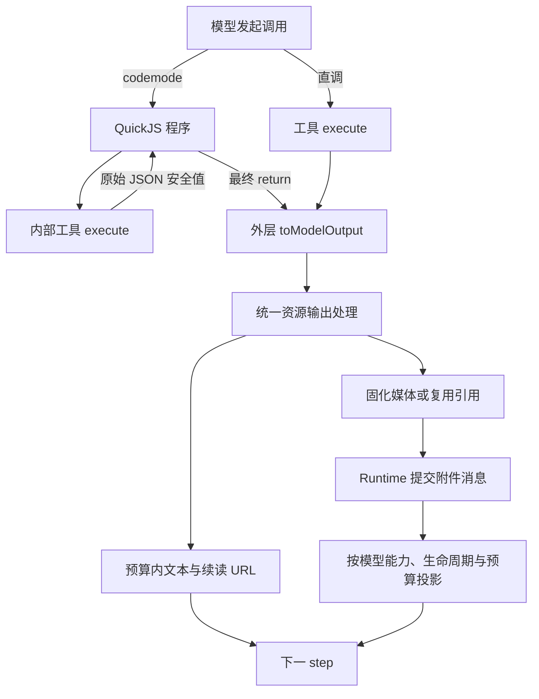

Agent 可以先发现需要的工具，再用程序组织多次调用，通过资源 URL 读取与传递数据。codemode、toolsearch 与资源中心分别处理调用表达、能力发现和数据访问，三者可以在同一个 profile 中配合使用。

## 从发现能力到保存结果

假设 workspace 扩展已经启用，沙箱的 `/home/workspace/notes.txt` 中保存着逐行记录，其中待办以 `TODO:` 开头。Agent 可以读取这些记录，筛选待办并保存为一个新文件。

先在 profile 中启用两项能力：

```yaml
codemode:
  enable: true
toolsearch:
  enable: true
```

两项默认关闭。启用后，非常驻工具进入待发现的工具池；`search` 返回命中项，从下一步开始加入可用工具目录。目录默认按增量更新，与 codemode 配合时会提供程序调用所需的签名。

模型先调用：

```ts
search({ query: "write_file" })
```

在后续模型步骤中，可以通过 `codemode` 执行以下程序：

```js
const source = await tools.read({
  url: "workspace:///home/workspace/notes.txt",
});
if (source.type !== "text") throw new Error("待办来源需要是文本文件");

const tasks = source.text.split("\n").filter((line) => line.startsWith("TODO:"));
await tools.write_file({
  path: "/home/workspace/tasks.txt",
  content: tasks.join("\n"),
});
return {
  count: tasks.length,
  url: "workspace:///home/workspace/tasks.txt",
};
```

`read` 通过 workspace 注册的 scheme 读取同一沙箱中的文件，程序使用返回的完整文本，`write_file` 接收整理后的内容。模型最后只收到待办数量与新文件的资源 URL，可以继续读取或处理结果。工具之间的中间数据留在程序中。

新增业务工具可以继续进入 codemode 的程序调用目录，toolsearch 按需披露其定义；资源 handler 则可以增加 `read` 能够访问的数据来源。比如扩展注册 HTTP(S) handler 后，网络内容也能经由 `read` 获取。handler 的访问策略、资源 URL 的解析与生命周期由所属 runtime 及扩展管理。

## 调用与模型出口



原生工具调用与文本协议引擎都先执行工具，再进入模型出口。文本协议负责把 JSON/XML 等输出解析成工具调用，不改变资源处理规则。

codemode 内部只执行工具的 execute，不调用内部工具的 toModelOutput。代码按当前目录的 outputSchema 读取返回值，再把需要的字段交给另一个工具。中间结果不因模型展示预算截断或归档；现有 SDK 的传输大小、最终结果、内存和超时限制仍然有效。

`send_message` 在直调和 codemode 两侧可达；`finish`、`wait` 只留直调目录。每次 codemode 调用启动独立程序，需要给下一步的数据必须最终 return。

## 最终返回值中的媒体

codemode 在最终业务返回值的顶层 `attachments` 数组中声明要交给模型的媒体。支持 MCP image/audio、read 的 file 节点、嵌入 MCP resource 和明确的资源引用；数组外的一切按普通 JSON 处理，不递归猜测媒体。

提交新数据时，以实际字节为准。只有 URL 时，统一出口解析它：已固化内容可以复用，workspace 等实时媒体引用则固化快照。附件关联外层 codemode 调用，因为只有最终 return 才决定哪些内部结果交给模型。媒体项可以带 `lifetime`（`once` 默认、`recent`、`retain`）；沙箱内部工具返回的原始媒体不产生附件生命周期，只有最终 `attachments[]` 里的声明生效。

资源 URL 标识数据的访问地址。接收工具要求 base64 时，程序先 `read`，再传入返回的 `data`；接收工具支持对应 scheme 时，可以直接传入 URL。工具入参遵循各自的输入契约。

## 文本固化与原来源续读

工具原生 toModelOutput 先决定展示表示，例如 bash 的 stdout/stderr 拼排；统一出口在这个表示上抽取媒体、处理文本预算。

**普通超长内容**完整固化为 artifact，模型看到前缀与 Continue。归档保存媒体替换后的完整展示内容，不额外保存 execute 原始对象。例如动态 `example://large.text` 首次返回大段内容后，后续读取的是这次响应的 artifact，不再逐页调用 example。

**FileScheme 文本**已有可以直接读取的来源，使用原 URL 分页。local、workspace、已有 artifact 的读取页不再复制成页面 artifact。FileScheme 自行解释范围、view 和 offset，中心只路由完整 URL。

所有展示正文和续读说明共用 2000 行 / 30,000 个 UTF-16 code unit。Continue 保存请求范围与位置，超长单行也可以读完；截断不拆开 Unicode 代理对。每次续读前进，到达范围末尾后不再生成锚点。

普通 URL 可以表示当前资源，原来源续读不承诺跨次一致性；artifact 表示已保存的内容快照。

## 附件消息与请求投影

资源处理返回模型可见内容和附件引用，由 Runtime 提交 `ishiki.attachment`。下一 step 请求时，附件按当前模型能力、生命周期与请求预算转换成 user message 内容：

- 每个媒体项带 `lifetime`，默认 `once`：平台图片、直接 MCP 返回和 `read` 返回的媒体都只嵌入一次，只有携带图片的模型响应成功持久化后才消耗展示机会；失败或中止的 step 不消耗展示机会，后续请求重试。codemode 最终 `attachments[]` 的媒体项可以显式声明 `lifetime`；`imageInput` 开启时，直接调用的 `read` 接受 `lifetime`，沙箱内的 `read` 不提供。
- `recent` 保留最近查看过的图片：投影前统计活动图片总数（含未查看），超出 `recentImageCount` 的差额按 `imagePruneBatchSize` 成批移除最旧的**已查看**图片，未查看的图片不参与。`retain` 在来源记录仍处活动上下文时每轮参与选择。两者都依赖来源记录仍在活动上下文中：来源记录被移除时释放，已经持久化的交付状态也不会让图片复活。
- 每请求另有张数、字节及尺寸预算，平台和工具附件共用。容量不足的图片本次请求不嵌入、不消耗展示机会，按到达顺序等待后续请求；硬预算下未被选中的已查看 `recent` 图片会释放，未查看的图片只等待容量，`retain` 本次暂不携带后仍可再试。
- 终止性判定（能力关闭、媒体类型或编码不支持、图片自身字节超过单图上限、图片自身字节超过单次请求累计上限、图片尺寸超限）只输出一次原因，并随成功响应持久化；资源不可用与请求剩余容量不足属于本次请求未提供，会在后续请求重试。
- 来源关联检查在 context engine 可能折叠工具结果之前执行；原消息撤回或工具结果不在历史中时，附件不能脱离来源继续展示。
- `imageInput: false` 时，附件消息只说明未提供视觉内容，代码仍能把实际媒体数据交给其他工具。

历史附件保存资源引用和来源关联，不保存某次请求的展示选择；交付状态与成功的助手响应在同一批写入中持久化，跨重启保留。未发生生命周期移除或选择变化时，投影出的消息保持顺序、ID 与时间戳不变，provider 可以复用前缀缓存；字节级复用只对 `immutable` 资源成立。

## read 的两个出口

read 的原始结果是结构化数据：文本含完整 text 和可选的文件来源，媒体含 base64 data、类型与来源。原始数据适合 codemode 使用；只有模型转换阶段才生成页面或媒体附件。模型侧的媒体默认 `once`；`imageInput` 开启时直调 `read` 可传 `lifetime`，codemode 内的 `read` 不接受这个参数。

FileScheme 将读取来源保存为可序列化数据，统一出口根据这一来源生成续读位置。普通长文本使用 artifact 快照保存完整内容，再提供分页结果。

## 继续阅读

<Cards>
  <Card
    title="模型工具与资源协议"
    description="内置工具、结构化 read、文件范围和文本预算"
    href="/docs/reference/tools"
  />
  <Card
    title="启用工作区"
    description="沙箱、挂载文件、workspace URL 与技能"
    href="/docs/guides/workspace"
  />
  <Card
    title="扩展 API 参考"
    description="贡献工具、引擎与完整 URL handler"
    href="/docs/reference/api"
  />
</Cards>
