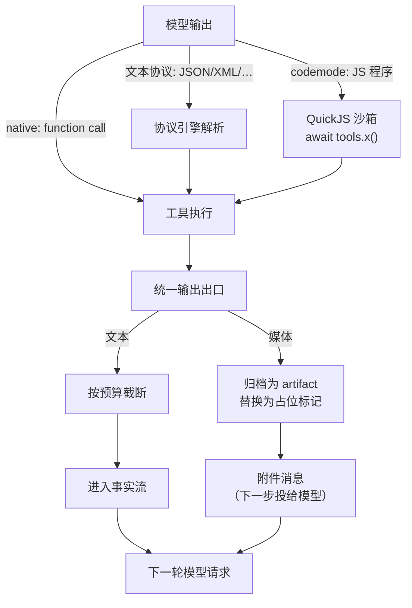

模型按下工具按钮之后、看到结果之前，结果经历了一整条流水线：协议解析、执行、统一出口、附件投影。理解这条流水线，能解释大部分「为什么工具返回长这样」的疑问。

## 全景



## 出发：三种调用形态

**原生调用（native 引擎）**：模型输出结构化的 function call，直接执行。最可靠，前提是模型支持。

**文本协议（v3/hermes/qwen3coder/morph-xml/yaml-xml 引擎）**：模型把调用写进普通文本（如 v3 的 ```json 块），协议引擎注入协议说明、解析输出、提取调用。解析失败按错误处理，不会静默丢弃。适合无原生 function call 能力的模型。

**codemode（代码模式）**：模型改写一段 JS 程序，程序在 QuickJS 沙箱里 `await tools.x(input)` 调工具。关键差异：**中间数据不出沙箱**。十个工具的串联结果在程序内自由传递，模型只看到最终返回值。

<Callout title="codemode 的两条固定规则">
`send_message` 在沙箱与直调两面都可达（程序里也能说话）；`finish` 只留直调目录（收尾必须由模型亲自发起）。`direct` 名单调整其余工具的归属。
</Callout>

codemode 传媒体出沙箱只有一条路：返回值顶层 `attachment` 数组。数组里的块（MCP image/audio、read 的 file 节点、内嵌 resource）被归档并以附件消息投给下一步；数组外的一切按普通 JSON 处理（会被截断预算约束）。

## 归宿：统一输出出口

不管哪种形态，工具结果都过同一个出口（`processOutput`）：

1. **文本**：按全局文本预算截断（2000 行 / 单行 2000 字符 / 30,000 字符），截断带 Continue 锚点。工具自己的 `toModelOutput` 转换优先于默认渲染（如 bash 工具的 `exit code/stdout/stderr` 拼排）。
2. **媒体**：字节归档为 `artifact://<工具名>/<内容寻址名>`，模型看到的位置替换为占位标记 `[attachment: artifact://…; image/png; 12345 bytes]`。**工具结果里从此不再有裸 base64**——这是上下文不被媒体撑爆的关键。
3. **codemode 的 attachment 数组**：同样归档，但额外生成一条附件消息。

归档是幂等的：同一字节（SHA-256 相同）重复产生不重复占盘。

## 回流：附件消息与投影

归档的媒体以 `ishiki.attachment` 消息进入事实流，在**下一轮请求**时经附件投影投给模型：

- 配额（张数/字节/尺寸）每请求一份、最新优先——新截图挤不掉，古老的大图先出局，出局者保留 URL 与原因。
- 来源消息被撤回（或工具结果已不在投影里）的附件自动消失——附件永远跟着它的宿主走。
- `imageInput: false` 时，模型收到的是附件的描述与元数据而非像素；但 codemode 内字节仍可流转给其他工具。

## read 工具的特殊地位

`read` 是唯一「模型主动读资源」的通道，它和统一出口共享同一份预算：read 自己截断并附锚点，出口不再二次截断归档。这让「分段读大文件」成为可能：每段按锚点续读，行号始终对齐源文件。

二进制资源 read 返回 base64 文件节点——在 codemode 里这个节点可以原样塞进 `attachment` 数组或传给下一个工具；直调时它转为附件自动投给下一步。

## 设计动机小结

这条流水线反复出现的主题是**预算与留痕**：媒体永远留痕（URL 可回溯）不占预算；文本按预算截断但留续读锚点；事实流永远完整（截断只发生在投影层）。于是「历史」与「知觉」分离：什么都没丢，只是每轮请求选择性地看见。

## 继续阅读

<Cards>
  <Card
    title="模型工具与资源协议"
    description="五个内置工具的输入输出与资源 URL 语法"
    href="/docs/reference/tools"
  />
  <Card
    title="启用工作区"
    description="bash / read_file / write_file / edit_file 与技能注入"
    href="/docs/guides/workspace"
  />
  <Card
    title="扩展 API 参考"
    description="贡献工具、引擎与资源方案"
    href="/docs/reference/api"
  />
</Cards>
