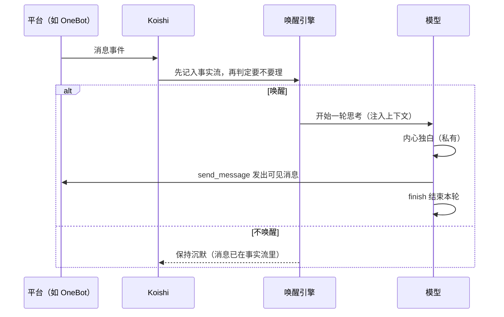

Ishiki（意识）是一个 Koishi 插件，让大语言模型以「一个真实的人」的方式生活在你的群聊和私聊里：它按事件醒来、自行决定要不要说话、能调用工具做事，并始终以你写的人格（persona）存在。

## 它解决什么问题

普通聊天机器人是「请求—响应」模型：收到消息就回复。Ishiki 把对话当作**事件流**来处理：

- **意识不是连续的**。核心没有内建的持续思考循环：默认情况下 runtime 因输入而醒来，但唤醒还有别的来路——模型自己声明的等待条件、唤醒引擎的机械信号、以及扩展或宿主安排的外部唤醒，三者任一都能打开一轮。每次醒来处理一轮事件，然后沉寂，两次醒来之间什么都不运行。
- **说话是一种选择**。消息进来后先经过唤醒引擎判断「要不要理」，被 @ 、私聊、命中关键词、或者模型自己判断「此刻有话想说」，才开口。沉默不需要理由，也不需要表演。
- **发言只走一个出口**。模型写的普通文本是它的内心独白，别人看不见；只有显式调用 `send_message` 工具，消息才会真正发到平台上。
- **能做事，不只是聊天**。通过内置工具和扩展接入的 MCP 服务器、工作区（文件与命令执行）等能力，它可以查资料、读图片、执行命令，再把结果用自然的方式带进对话。

## 一次典型的醒来

## 与前身 YesImBot 的关系

Ishiki 是 YesImBot（Athena）设计思想的延续与重写。YesImBot 的核心概念——场景化人格、响应意愿、消息级事件——在 Ishiki 中以 profile、唤醒引擎、上下文引擎的形式继续存在；YesImBot 自带的平台翻译层、模型 Provider 插件体系则不再保留，改由 Koishi 原生适配器加 `models.yaml` 模型网关承担。

<Callout type="warn">
两个项目相互独立、不能混装：同时启用 YesImBot 与 Ishiki 会出现重复响应与配置冲突。
</Callout>

## 它适合谁

<Cards>
  <Card
    title="Koishi 用户"
    description="想要一个像人一样参与群聊的机器人，从快速上手开始"
    href="/docs/tutorial/quickstart"
  />
  <Card
    title="部署者"
    description="想精细控制唤醒策略、上下文窗口、模型故障转移与故障恢复"
    href="/docs/guides/wakeup"
  />
  <Card
    title="扩展开发者"
    description="想为它写工具、替换引擎或接入新的资源方案"
    href="/docs/reference/api"
  />
  <Card
    title="只想先看看"
    description="从架构总览开始，理解它为什么长成现在这样"
    href="/docs/explanations/architecture"
  />
</Cards>

## 当前状态

<Callout type="warn" title="0.0.x 活跃开发期">
各包尚未上架 npm 与 Koishi 插件市场，安装以源码构建接入为准，见[快速上手](/docs/tutorial/quickstart)。
</Callout>

配置字段随版本演进，本文档以当前仓库源码为准；字段变更时请以 `packages/koishi-plugin-ishiki/src/profile/config.ts` 为最终依据。
