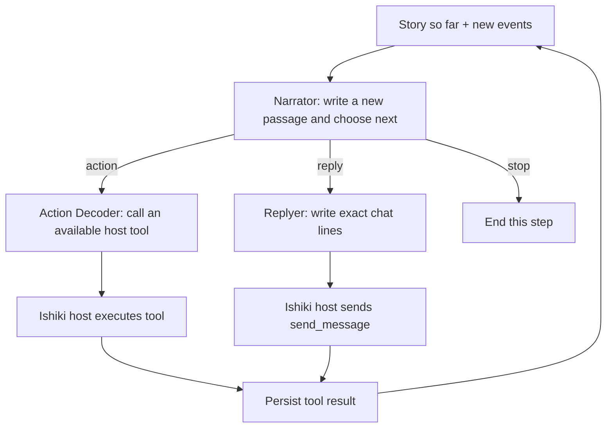

# Ishiki Narrative

Ishiki Narrative lets one ordinary Ishiki model step run a small, multi-model conversation pipeline. A Narrator advances a persistent story and chooses what should happen next; an Action Decoder can translate an action into a host tool call, or a Replyer can write the user-facing message. Ishiki still owns the agent loop, tool execution, and session storage.

The package is a focused example of changing a model's internal work through Ishiki's existing engine extension points, without adding a narrative-specific branch to the core runtime. It implements one narrative capability inspired by HDS-Interlude; it does not integrate HDSI or replace its wider system.

## How it works

A profile selects two cooperating engines:

- The **Narrative ContextEngine** keeps each runtime's story alongside its event ledger. It projects the committed script, newly arrived events, recent exact evidence, and attachments into the model input. New messages are narrated incrementally; original events remain in storage. When the script exceeds its approximate budget, the older story is condensed while recent evidence is retained.
- The **Narrative ToolcallEngine** wraps the profile's `LanguageModelV4`. The wrapper is shared at profile scope and holds no conversation state; it orchestrates stages from the input assembled by that runtime's ContextEngine.

Each model step follows this path:



The Narrator returns a script increment and a next-step intent. The Action Decoder receives the actual tools available in that step and produces standard tool calls; it does not execute them. Ishiki runs the tools and persists their results. On a later model step, those results become evidence for the Narrator. For a reply, the Replyer produces exact message strings that the wrapper packages as the existing `send_message` tool.

Narrative increments are stored as `ishiki.narrative` entries in the same session ledger as the conversation. The script is an explicit, model-generated narrative state—not hidden chain-of-thought extracted from a provider. The marked assistant reasoning part is the durable source for recovering a missing projection after restart. Original messages and tool records are not replaced by prose.

## Install and enable

Install `koishi-plugin-ishiki-narrative` alongside `koishi-plugin-ishiki`, then load the plugin in the same Koishi application before Ishiki loads profiles:

```ts
import narrative from "koishi-plugin-ishiki-narrative";

ctx.plugin(narrative);
```

The plugin registers both providers:

- `ishiki.engine.context.narrative`
- `ishiki.engine.toolcall.narrative`

Select **both** for a profile. The core does not currently reject a profile that selects only one, so keeping the pair aligned is a configuration requirement.

```yaml
model: provider:narrator
context:
  engine: narrative
  narrative:
    maxTokens: 32000
    refillRatio: 0.8
    recentEntries: 12
toolcall:
  engine: narrative
  narrative:
    decoderModel: provider:agent
    replyModel: provider:writer
```

Replace the `provider:model` references with models declared in Ishiki's `models.yaml`; gateway group names are also accepted. The profile's `model` is the Narrator model. If `decoderModel` or `replyModel` is omitted, that stage reuses the profile model but still makes a separate model call.

Optional role-specific prompt additions can be supplied under `toolcall.narrative`:

```yaml
toolcall:
  engine: narrative
  narrative:
    decoderModel: provider:agent
    replyModel: provider:writer
    narratorInstructions: "Keep new observations distinct from guesses about other people's motives."
    decoderInstructions: "Use exact identifiers from the supplied evidence."
    replyerInstructions: "Write concise chat bubbles in the character's voice."
```

These instructions extend the built-in stage contracts. They do not replace the persona, the available host tools, or the output schema.

### Context budget

| Setting         | Default | Meaning                                                                                                                                                 |
| --------------- | ------: | ------------------------------------------------------------------------------------------------------------------------------------------------------- |
| `maxTokens`     | `32000` | Approximate budget for stored narrative text, not a hard limit on the complete model request.                                                           |
| `refillRatio`   |   `0.8` | Target fraction of that budget after a compaction.                                                                                                      |
| `recentEntries` |    `12` | Extra recent source entries replayed as exact evidence. New/unprocessed input, active-turn evidence, and linked attachments are retained independently. |

The token budget is estimated from text length. Compaction can lose detail; the original ledger remains available, and recent source records are kept verbatim in the model input.

## Why this fits Ishiki

The package composes two existing seams instead of forking the agent loop:

1. The ContextEngine provides the per-runtime boundary for persistent narrative state and context projection.
2. The ToolcallEngine receives the profile model through the existing `LanguageModelV4` seam and can coordinate additional model calls behind the ordinary model interface.
3. Standard tool calls return to Ishiki's existing host, which retains authority over tools, storage, attachments, and turn lifecycle.

This keeps story state out of the profile-shared model wrapper and avoids a second agent runtime or a second tool executor. Other model pipelines can use the same architecture: the internal stages may change while the surrounding Agent continues to speak the LanguageModel interface and receive ordinary tool calls.

## Current limits

- This package does not expose an HTTP Chat Completions or Responses server. It participates in Ishiki's existing Agent model calls.
- The two narrative engines are designed as a pair, but the current runtime does not enforce that pairing. Set both engine names to `narrative` in each profile.
- Narrator, Replyer, and compaction stages request JSON output and parse it strictly. A provider can still return malformed or incomplete JSON; that fails the model step rather than being silently repaired.
- Narrative quality depends on the selected models, their instructions, and the evidence they receive. The pipeline provides role separation and continuity; it does not guarantee a particular writing quality or persona.
- A single Agent model step can make several upstream model calls, and context compaction can add another. Expect additional latency and token usage compared with a single-model step.
- This is one application of narrative orchestration, not a complete reproduction of HDS-Interlude's scheduling, delivery, and broader life-simulation system.
