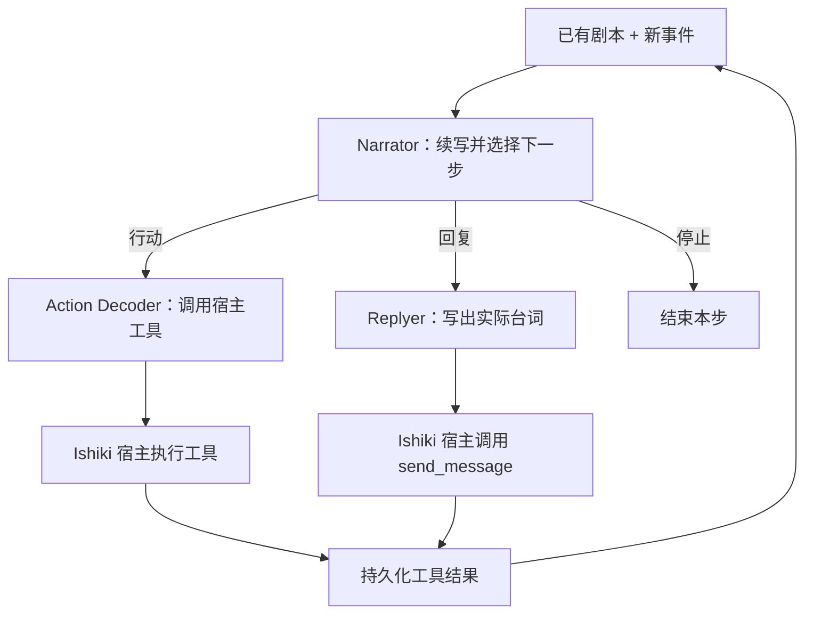

# Ishiki Narrative

Ishiki Narrative 可以把一次普通的 Ishiki 模型调用，编排成多个角色模型协作的推理流程：Narrator 推进持续发展的剧本并选择下一步；Action Decoder 将行动意图转换为宿主工具调用，或由 Replyer 写出面向用户的回复。Agent 循环、工具执行和会话存储仍由 Ishiki 负责。

这个插件展示了如何利用 Ishiki 已有的引擎扩展点改变模型调用内部的工作方式，而不为 narrative 在核心运行时增加专属分支。它参考了 HDS-Interlude 的剧本概念，只实现其中一种叙事能力；它没有集成 HDSI，也不试图替代 HDSI 的完整系统。

## 工作机制

Profile 选择两个协同工作的引擎：

- **Narrative ContextEngine** 在每个 runtime 的会话台账中维护剧本。它把已提交的剧本、新到事件、近期精确证据和附件投影到模型输入。新消息按增量叙事化，原始事件仍留在台账中。剧本超过近似预算后，系统会压缩较早的叙事，同时保留近期证据。
- **Narrative ToolcallEngine** 包装 profile 的 `LanguageModelV4`。包装器在 profile 级共享且不保存会话状态；它根据对应 runtime 的 ContextEngine 组装出的输入协调各个模型阶段。

每个模型步骤大致经过以下流程：



Narrator 返回一段剧本增量和下一步意图。Action Decoder 会收到本步实际可用的工具定义，并生成标准工具调用；它本身不执行工具。Ishiki 宿主负责执行并持久化结果，后续模型步骤再将这些结果作为 Narrator 的证据。若下一步是回复，Replyer 写出实际聊天内容，由包装器封装为现有的 `send_message` 工具调用。

剧本增量以 `ishiki.narrative` 条目保存在同一份会话台账中。剧本是模型明确生成的叙事状态，并非从 provider 提取的隐藏思维链。带标记的 assistant reasoning part 是持久来源：进程重启后，如果投影条目缺失，可以从已保存的输出恢复。原始消息和工具记录不会被剧本文本替代。

## 安装与启用

将 `koishi-plugin-ishiki-narrative` 与 `koishi-plugin-ishiki` 一起安装，并在同一个 Koishi 应用中、Ishiki 加载 profile 之前启用该插件：

```ts
import narrative from "koishi-plugin-ishiki-narrative";

ctx.plugin(narrative);
```

该插件会注册两个引擎服务：

- `ishiki.engine.context.narrative`
- `ishiki.engine.toolcall.narrative`

一个 profile 应同时选择这两个引擎。当前核心不会拒绝只选择其中一个的 profile，因此必须由配置者确保二者配套。

```yaml
model: provider:narrator
context:
  engine: narrative
  narrative:
    maxTokens: 32000
    refillRatio: 0.8
    recentEntries: 12
toolcall:
  engine: narrative
  narrative:
    decoderModel: provider:agent
    replyModel: provider:writer
```

请将 `provider:model` 替换为 Ishiki `models.yaml` 中声明的模型，也可以使用 gateway group。Profile 的 `model` 用作 Narrator 模型。若省略 `decoderModel` 或 `replyModel`，对应阶段会复用 profile 模型，但仍会进行独立的一次模型调用。

可以在 `toolcall.narrative` 下为各角色追加提示词要求：

```yaml
toolcall:
  engine: narrative
  narrative:
    decoderModel: provider:agent
    replyModel: provider:writer
    narratorInstructions: "Keep new observations distinct from guesses about other people's motives."
    decoderInstructions: "Use exact identifiers from the supplied evidence."
    replyerInstructions: "Write concise chat bubbles in the character's voice."
```

这些指令用于扩展各阶段内置的职责约定，不会替代人设、宿主实际提供的工具或输出 schema。

### 上下文预算

| 配置项          |  默认值 | 含义                                                                                                     |
| --------------- | ------: | -------------------------------------------------------------------------------------------------------- |
| `maxTokens`     | `32000` | 剧本正文的近似预算，不是整个模型请求的硬性上限。                                                         |
| `refillRatio`   |   `0.8` | 压缩后希望达到的预算占比。                                                                               |
| `recentEntries` |    `12` | 额外作为精确证据重放的近期源条目数量。未处理输入、当前轮需要的证据和关联附件会独立保留，不受该数值限制。 |

Token 数由文本长度估算。压缩可能损失细节；原始台账不会被删除，近期源记录也会以原文形式保留在模型输入中。

## 为什么适合 Ishiki

该插件组合现有扩展点，而不是复制 Agent 循环：

1. ContextEngine 提供每个 runtime 独立的持久状态边界和上下文投影。
2. ToolcallEngine 通过现有 `LanguageModelV4` 接入 profile 模型，并在普通模型接口后协调额外的模型调用。
3. 标准工具调用交回 Ishiki 宿主，由宿主继续掌握工具、存储、附件和轮次生命周期。

因此，剧本状态不需要放进 profile 级共享模型包装器，也不需要增加第二套 Agent runtime 或工具执行器。其他模型 pipeline 也可以沿用这种结构：内部阶段可以变化，外围 Agent 仍通过 `LanguageModel` 接口交互并接收标准工具调用。

## 当前限制

- 本插件不提供 Chat Completions 或 Responses HTTP 服务，只参与 Ishiki 已有的 Agent 模型调用。
- Narrative ContextEngine 和 ToolcallEngine 需要配套，但当前运行时不会强制校验。每个 profile 都应将两项都设为 `narrative`。
- Narrator、Replyer 和历史压缩阶段会请求 JSON 输出，并严格解析。Provider 仍可能返回格式错误或不完整的 JSON；这种情况会使本步失败，而不是被静默修补。
- 叙事质量取决于所选模型、提示词和输入证据。Pipeline 提供了角色分工与连续性机制，但不保证特定文风或人设效果。
- 一次 Agent 模型步骤可能触发多次上游模型调用；上下文压缩还可能增加额外调用。与单模型单次调用相比，应预期更高的延迟和 token 用量。
- 这是叙事编排的一种应用，并非 HDS-Interlude 中调度、投递和更完整生活模拟系统的复刻。
