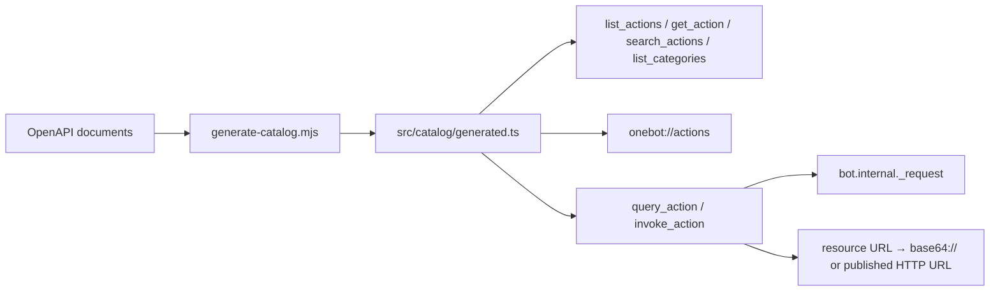

# Ishiki OneBot

`koishi-plugin-ishiki-onebot` gives an Ishiki agent the OneBot v11 actions that core tools do not cover: group administration, group files and albums, message history, reactions, friend management, and profile edits.

It supports two protocol backends, NapCat and SnowLuma. Ordinary conversation still goes through `send_message`; this pack only fills in protocol-specific operations.

## How it works

A catalog generated at build time from both projects' OpenAPI documents drives everything: the tools, the `onebot://actions` resource, backend-specific parameters, and the read-only classification. Nothing is fetched at runtime.



The two backends differ in more than naming. Of 205 canonical actions, 160 exist on both, 174 on NapCat, and 191 on SnowLuma; 68 shared actions have different parameter shapes. The catalog keeps those differences instead of averaging them away, and it records each backend's wire name, because a folded alias can map to different action names (`share_peer` is `ArkSharePeer` on NapCat).

## Install and enable

Build and link `packages/onebot` (`koishi-plugin-ishiki-onebot`) the same way as the other extension packs, enable it in `koishi.yml`, then declare it in a profile:

```yaml
plugins:
  ishiki-onebot: {}
```

```yaml
extends:
  onebot:
    config:
      backend: napcat # required: napcat | snowluma
      mode: read # docs | read | write, default read
```

| Field             | Default          | Meaning                                                                                        |
| ----------------- | ---------------- | ---------------------------------------------------------------------------------------------- |
| `backend`         | required         | Selects the action set, parameter shape, and read-only classification.                         |
| `mode`            | `read`           | `docs` only answers catalog questions; `read` adds read-only execution; `write` adds all.      |
| `maxInlineBytes`  | 8 MiB            | Limit for converting a resource URL into `base64://`; larger bytes fail instead of truncating. |
| `resourceBaseUrl` | Koishi `selfUrl` | Origin the protocol backend uses to reach Koishi's HTTP service.                               |
| `denyActions`     | `[]`             | Extra action names or aliases to refuse.                                                       |
| `logLevel`        | `INFO`           | Plugin log level.                                                                              |

## Tools

| Tool              | Mode        | Purpose                                                                 |
| ----------------- | ----------- | ----------------------------------------------------------------------- |
| `list_actions`    | all         | Lightweight index, optionally filtered by category.                     |
| `get_action`      | all         | One action's parameters, required fields, backend differences, aliases. |
| `search_actions`  | all         | Matches names, summaries, aliases, categories, and parameter names.     |
| `list_categories` | all         | Categories with action counts.                                          |
| `query_action`    | read, write | Executes read-only actions only.                                        |
| `invoke_action`   | write       | Executes any known action, including ones with side effects.            |

Mode alone is not the permission boundary: `query_action` always refuses actions the current backend does not mark read-only, `invoke_action` refuses to run outside `write`, and `denyActions` applies on both paths.

The same data is a resource: `onebot://actions` is the categorized index, and `onebot://actions/<name>` is one action's page. Both are readable with the `read` tool.

## Reading received files

Some OneBot backends supply only a filename in a file's `src`. If reading an `asset://...` resource reports no downloadable source, read the `?view=meta` URL from the error and take `file_id` from `sourceInfo.fileId`. Use `get_private_file_url` for private files, or `get_group_file_url` with `group_id` for group files. Look up the current backend's full parameters with `get_action`.

In `read` or `write` mode, discover both `query_action` and the download tool first. Within one codemode execution, retrieve the URL, check `retcode`, and pass `data.url` directly to the download tool using a local variable. When using `bash`, quote the value for the current shell. Return only the download result or subsequent processing result; keep the temporary URL out of returned output, later model-authored calls, and replies. The core `read` tool reads registered resource URLs; HTTP(S) URLs need a download tool.

## Media parameters

Parameters that carry media accept any registered resource URL (`asset://`, `artifact://`, `local://`, `workspace://`, `skill://`, `mcp://`):

- By default the bytes become `base64://`, which both backends accept.
- Parameters that require a URL instead (SnowLuma's `ocr_image.image`, `send_tuwen_ark.preview_url`, the image fields of `get_mini_app_ark`, and `download_file.url`) are published through Koishi's HTTP service as a temporary URL.
- `http(s)://`, `base64://`, `data:`, `file://`, and host paths pass through untouched.
- Text resources and bytes above `maxInlineBytes` fail with a message; nothing is truncated.

Published URLs live under `/ishiki-onebot/<profile token>/resources/<id>`, one route per profile. Entries expire after ten minutes; a profile keeps at most eight, 32 MiB total. When the protocol backend cannot reach Koishi at its own address, point `resourceBaseUrl` at an origin it can reach:

```yaml
extends:
  onebot:
    config:
      backend: snowluma
      mode: read
      resourceBaseUrl: http://host.docker.internal:5140
```

This needs Koishi's HTTP service (`@koishijs/plugin-server`). Without it, only URL-only media parameters fail; documentation, execution, and `base64://` conversion keep working.

## Catalog generation

`src/catalog/generated.ts` is committed, so neither building nor running needs the reference repositories. Regenerate it after updating either documentation checkout:

```bash
node packages/onebot/scripts/generate-catalog.mjs
node packages/onebot/scripts/generate-catalog.mjs --check   # exits non-zero when stale
```

The script reads `NAPCAT_DOCS` and `SNOWLUMA_DOCS`, defaulting to `D:/Codespace/references/NapCatDocs` and `D:/Codespace/references/SnowLumaDocs`. It uses the newest NapCat OpenAPI document for parameters and scans every version to record when an action first appeared; SnowLuma's `catalog.json` supplies its read-only flags and aliases, since its OpenAPI does not carry them.

Two generation rules are worth knowing:

- NapCat has no read-only flag. Actions are classified by name prefix, then corrected by an override table for the cases the prefix gets wrong (`get_ai_record`, `_mark_all_as_read`, `ocr_image`, and others).
- OpenAPI lists some parameters with a `default` as required. Those are treated as optional, because the backend fills them in.

## Safety

- `bot_exit`, `set_restart`, `send_packet`, `get_cookies`, `get_credentials`, and `get_csrf_token` are always disabled, with the reason recorded in the catalog.
- `denyActions` accepts either the canonical name or an alias.
- Cross-channel profiles must pass `account`, and it must be one of the profile's claimed accounts; channel profiles always use their own account.
- A non-zero `retcode` is returned as an ordinary result for the model to read; only transport failures raise.

## Current limits

- The catalog is a snapshot of the NapCat 4.18.38 and current SnowLuma documentation. An older NapCat returns an unknown-action error for newer actions; the error is passed back unchanged.
- SnowLuma's `ocr_image` accepts an HTTP(S) URL or a cached `file_id` only. The extension publishes resource bytes as a URL so the first form works; base64 and local paths remain rejected by that backend.
- Read-only classification is documentation metadata, not a guarantee about side effects. An action the backend marks read-only can still change state if its implementation does.
- Published media URLs are unauthenticated by design: the random path is the only secret, and entries expire quickly. Do not point `resourceBaseUrl` at a public origin unless that tradeoff is acceptable.
- This pack does not replace `send_message`. It has no typing pacing, no message assembly, and no cross-channel routing rules; those stay in the core tool.
