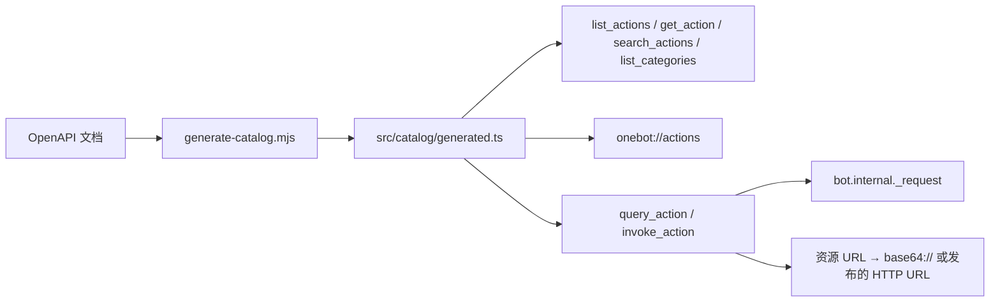

# Ishiki OneBot

`koishi-plugin-ishiki-onebot` 把核心工具没有覆盖的 OneBot v11 动作交给 Ishiki Agent：群管理、群文件与群相册、历史消息、表情回应、好友管理、资料修改。

它支持 NapCat 与 SnowLuma 两种协议后端。普通对话仍走 `send_message`；这个插件只补足协议特有的操作。

## 工作机制

构建期从两边的 OpenAPI 文档生成的目录是唯一数据来源：工具、`onebot://actions` 资源、后端差异参数、只读判定都由它派生。运行时不访问任何文档仓库。



两个后端的差异不止命名。205 个规范动作中，160 个两边都有，NapCat 有 174 个，SnowLuma 有 191 个；68 个共有动作的参数形状不同。目录保留这些差异，并记录每个后端各自的线上动作名，因为折叠后的别名可能对应不同名字（`share_peer` 在 NapCat 上是 `ArkSharePeer`）。

## 安装与启用

按其他扩展包同样的方式构建并链接 `packages/onebot`（包名 `koishi-plugin-ishiki-onebot`），在 `koishi.yml` 启用，然后在 profile 中声明：

```yaml
plugins:
  ishiki-onebot: {}
```

```yaml
extends:
  onebot:
    config:
      backend: napcat # 必填：napcat | snowluma
      mode: read # docs | read | write，默认 read
```

| 字段              | 默认                | 说明                                                           |
| ----------------- | ------------------- | -------------------------------------------------------------- |
| `backend`         | 必填                | 选择动作集合、参数形状与只读判定                               |
| `mode`            | `read`              | `docs` 只答目录问题；`read` 增加只读执行；`write` 增加全部执行 |
| `maxInlineBytes`  | 8 MiB               | 资源转 `base64://` 的字节上限，超限报错而不截断                |
| `resourceBaseUrl` | Koishi 的 `selfUrl` | 协议端访问 Koishi HTTP 服务用的 origin                         |
| `denyActions`     | `[]`                | 额外禁用的动作名或别名                                         |
| `logLevel`        | `INFO`              | 插件日志级别                                                   |

## 工具

| 工具              | 模式            | 用途                                 |
| ----------------- | --------------- | ------------------------------------ |
| `list_actions`    | 全部            | 轻量索引，可按分类过滤               |
| `get_action`      | 全部            | 单动作的参数、必填项、后端差异、别名 |
| `search_actions`  | 全部            | 匹配名称、摘要、别名、分类与参数名   |
| `list_categories` | 全部            | 分类与动作数量                       |
| `query_action`    | `read`、`write` | 只执行只读动作                       |
| `invoke_action`   | `write`         | 执行任意已知动作，包含有副作用的     |

模式不是唯一的权限边界：`query_action` 永远拒绝当前后端未标记为只读的动作，`invoke_action` 在非 `write` 模式直接报错，`denyActions` 在两条路径上都生效。

同一份数据也是资源：`onebot://actions` 是分类索引，`onebot://actions/<name>` 是单动作页面，都可以用 `read` 工具翻阅。

## 读取收到的文件

部分 OneBot 后端提供的文件 `src` 只有文件名。如果读取 `asset://...` 时收到没有可下载来源的提示，读取错误中给出的 `?view=meta` 地址，从 `sourceInfo.fileId` 获取 `file_id`。私聊文件使用 `get_private_file_url`；群文件使用 `get_group_file_url`，同时提供 `group_id`。通过 `get_action` 查看当前后端的完整参数。

在 `read` 或 `write` 模式下，先发现 `query_action` 和实际下载工具，再在同一次 codemode 执行中获取地址、检查 `retcode`、将 `data.url` 保存为局部变量并传给下载工具。使用 `bash` 时，根据当前 shell 正确引用变量值。最终只返回下载结果或后续处理结果，不输出临时地址，也不将地址复制到下一轮调用或普通回复中。核心 `read` 工具读取已注册的资源 URL，HTTP(S) 地址需要交给下载工具。

## 媒体参数

带媒体的参数接受任何已注册的资源 URL（`asset://`、`artifact://`、`local://`、`workspace://`、`skill://`、`mcp://`）：

- 默认把字节转成 `base64://`，两个后端都接受。
- 需要 URL 的参数（SnowLuma 的 `ocr_image.image`、`send_tuwen_ark.preview_url`、`get_mini_app_ark` 的图片字段、`download_file.url`）改为发布到 Koishi 的 HTTP 服务，返回临时 URL。
- `http(s)://`、`base64://`、`data:`、`file://` 与宿主路径原样透传。
- 文本资源与超过 `maxInlineBytes` 的字节直接报错，不做截断。

发布出来的 URL 位于 `/ishiki-onebot/<profile token>/resources/<id>`，每个 profile 一条路由。条目十分钟过期，一个 profile 最多保留 8 条、总计 32 MiB。协议端无法用 Koishi 自己的地址访问时，把 `resourceBaseUrl` 指向它能到达的 origin：

```yaml
extends:
  onebot:
    config:
      backend: snowluma
      mode: read
      resourceBaseUrl: http://host.docker.internal:5140
```

这需要 Koishi 的 HTTP 服务（`@koishijs/plugin-server`）。缺少它时只有需要 URL 的媒体参数会失败；目录查询、动作执行与 `base64://` 转换照常工作。

## 目录生成

`src/catalog/generated.ts` 已提交进仓库，构建与运行都不需要参考仓库。更新任何一边的文档后重新生成：

```bash
node packages/onebot/scripts/generate-catalog.mjs
node packages/onebot/scripts/generate-catalog.mjs --check   # 过期时退出非零
```

脚本读取 `NAPCAT_DOCS` 与 `SNOWLUMA_DOCS`，默认是 `D:/Codespace/references/NapCatDocs` 与 `D:/Codespace/references/SnowLumaDocs`。参数取自最新的 NapCat OpenAPI 文档；脚本会扫描全部版本，记录每个动作首次出现的版本。SnowLuma 的只读标记与别名取自它的 `catalog.json`，因为它的 OpenAPI 没有这两项。

有两条生成规则值得知道：

- NapCat 没有只读标记。动作按名称前缀分类，再用覆盖表修正前缀判断错误的几个（`get_ai_record`、`_mark_all_as_read`、`ocr_image` 等）。
- OpenAPI 把一部分带 `default` 的参数列为必填。这些按可选处理，因为后端会补上默认值。

## 安全边界

- `bot_exit`、`set_restart`、`send_packet`、`get_cookies`、`get_credentials`、`get_csrf_token` 始终禁用，原因记录在目录里。
- `denyActions` 接受规范名或别名。
- 跨频道 profile 必须传 `account`，且必须是该 profile 已认领的账号；频道 profile 固定使用自己的账号。
- `retcode` 非零作为普通结果交给模型阅读；只有传输失败才抛错。

## 当前限制

- 目录是 NapCat 4.18.38 与当前 SnowLuma 文档的快照。较旧的 NapCat 对新动作返回未知动作错误，该错误原样传回。
- SnowLuma 的 `ocr_image` 只接受 HTTP(S) URL 或已缓存的 `file_id`。扩展把资源字节发布成 URL 让第一种写法可用；base64 与本地路径仍会被该后端拒绝。
- 只读分类是文档元数据，不保证没有副作用。后端标记为只读的动作，其实现仍可能改变状态。
- 发布出来的媒体 URL 不设鉴权：随机路径是唯一的秘密，条目很快过期。除非能接受这个取舍，不要把 `resourceBaseUrl` 指向公网 origin。
- 这个插件不替代 `send_message`：没有打字节奏、没有消息组装、没有跨频道路由规则，那些仍留在核心工具里。
